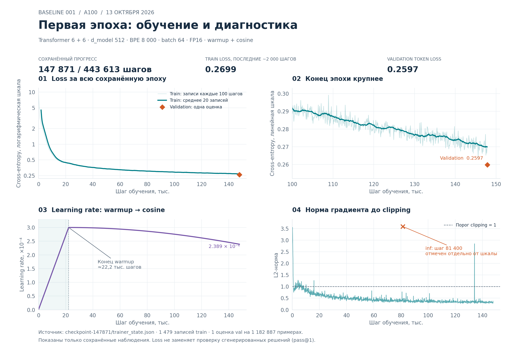
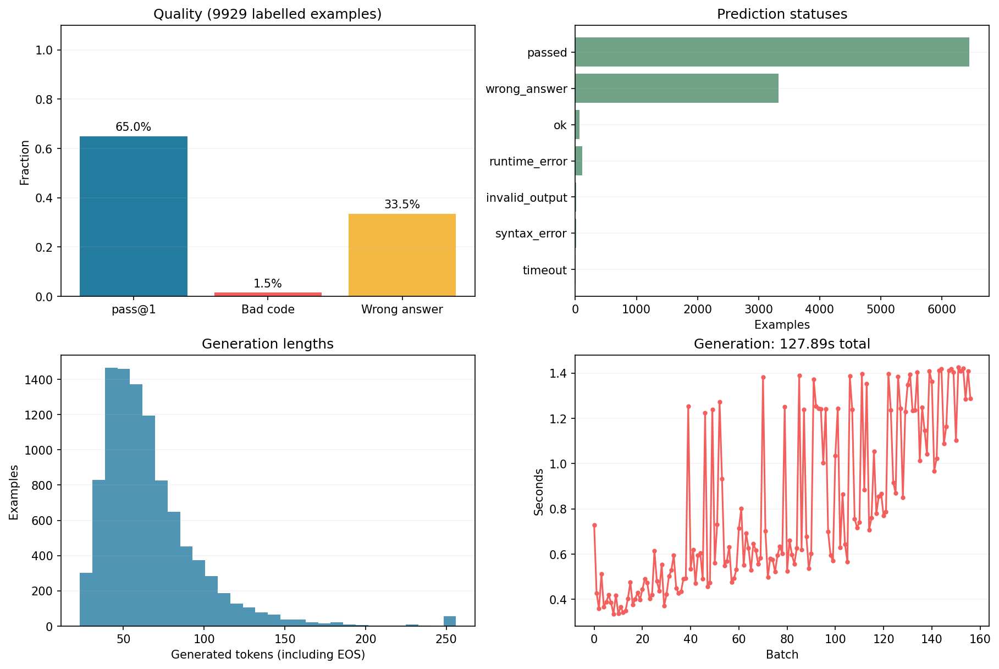
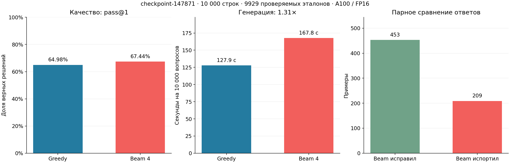
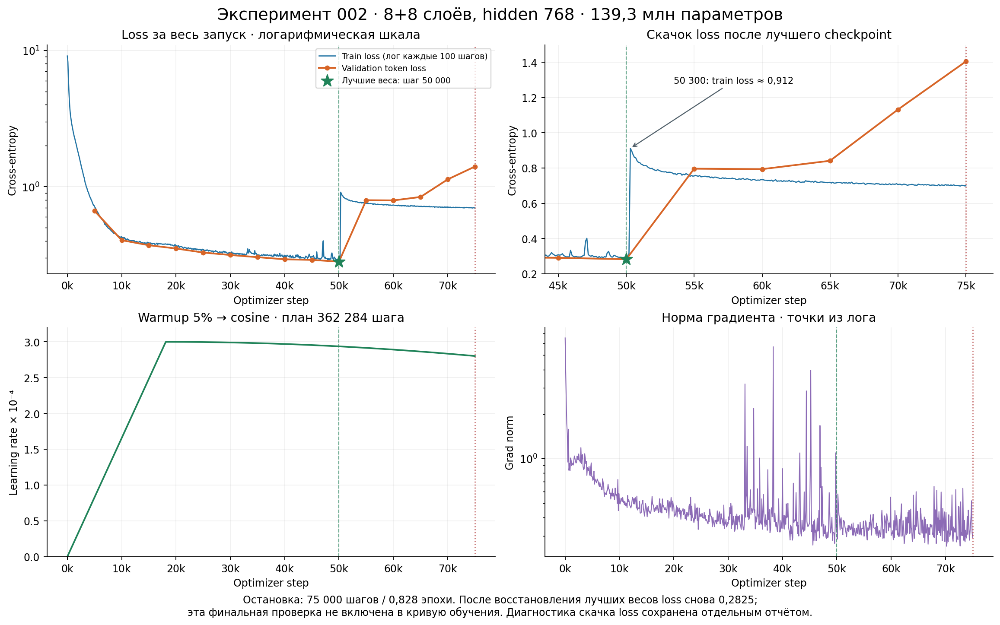
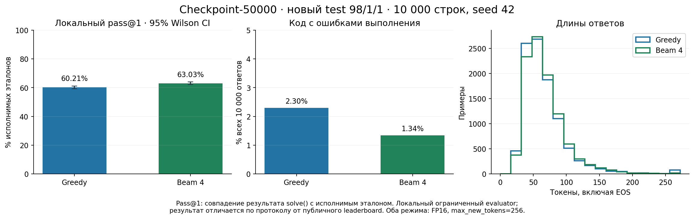
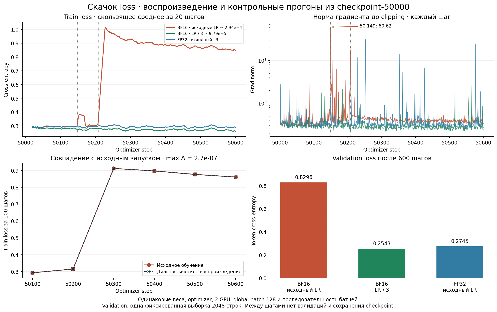
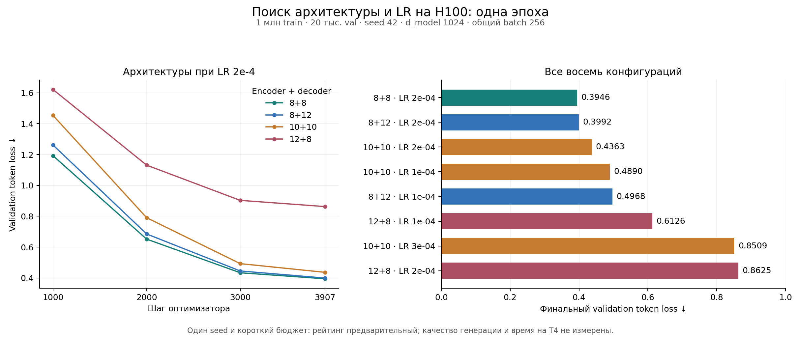

# Домашнее задание 2: генерация кода

Обучаем Transformer с нуля для генерации Python-кода по тексту задачи.
Этот README содержит описание решения и журнал работы, из которого будет
собран итоговый отчёт. После каждого изменения и эксперимента дополняем
соответствующую запись: что сделали, зачем, что получили и какой вывод сделали.

## Условия задания

[Текст задания](https://github.com/ashaba1in/hse-nlp/blob/2026/homeworks/hw2_code_generation.md).

- Архитектура: Transformer с энкодером текста и декодером кода.
- Генерация ответов для всего официального теста: не более 180 секунд на одной NVIDIA T4.
- Дополнительные обучающие данные и дополнительные таргеты запрещены.
- Спекулятивное декодирование запрещено — дополнительное ограничение,
  сообщённое 12 октября 2026.
- В отчёте описываем эксперименты и использование ИИ-агентов.
- Дедлайн решения: 24 октября 2026, 23:59; отчёта: 25 октября 2026, 23:59.

## Данные

Используем [SlavaYus/tinysms_qa_12m](https://huggingface.co/datasets/SlavaYus/tinysms_qa_12m).
По описанию датасета:

| Часть | Число строк | Столбцы |
| --- | ---: | --- |
| `train` | 11 838 003 | `question`, `code` |
| `test` | 1 919 | `question` |

Данные хранятся в Parquet. Обучение использует `question` как вход и `code`
как целевой текст. В исходном датасете docstring уже удалены, точка входа
переименована в `solve`. Официальный `test` сохраняем для итоговой генерации;
валидацию и при необходимости локальный тест выделяем из исходного `train`.

## Реализация

| Файл | Назначение |
| --- | --- |
| [load_dataset.py](load_dataset.py) | Скачивание через `huggingface_hub`; чтение одного Parquet в `Dataset` или всех частей в `DatasetDict`. |
| [prepare_datasets.py](prepare_datasets.py) | Удаление комментариев из столбцов с Python-кодом; разбиение на именованные части с seed и выбором столбцов. |
| [tokenizer.py](tokenizer.py) | Обучение собственного byte-level BPE на выбранных столбцах train с задаваемым размером словаря; сохранение в JSON. |
| [models/config.py](models/config.py) | Размеры Transformer, dropout, лимит длины и ID спецтокенов; создание конфигурации из токенизатора. |
| [models/base.py](models/base.py) | Общий интерфейс моделей, подготовка labels, подсчёт параметров и сохранение/загрузка checkpoint. |
| [models/baseline.py](models/baseline.py) | Первая encoder–decoder модель со случайной инициализацией; обучение с teacher forcing и генерация с KV-кэшем. |
| [training.py](training.py) | Обучение через `Seq2SeqTrainer`: конфигурация, подготовка батчей, валидация, логи и продолжение из checkpoint. |
| [train_distributed.py](train_distributed.py) | Запуск через `torchrun`: по процессу на GPU, продолжение checkpoint или новый эксперимент из его весов. |
| [utils.py](utils.py) | Вспомогательные функции; `get_device()` выбирает CUDA, затем MPS, затем CPU. |
| [tests/test_training.py](tests/test_training.py) | Проверки подготовки данных, нормировки loss, обновления весов и восстановления обучения. |
| [requirements.txt](requirements.txt) | Версии зависимостей, использованные при проверках реализации. |
| [inference.py](inference.py) | Батчевая генерация, загрузка `model.pt` или Trainer `checkpoint-N` с BPE, сохранение ответов и замер времени. |
| [evaluate_checkpoint.ipynb](evaluate_checkpoint.ipynb) | Выполненный ноутбук оценки первой эпохи на 10 000 отложенных примеров: метрики, графики и примеры ошибок. |
| [beam_search_comparison.ipynb](beam_search_comparison.ipynb) | Сравнение greedy и beam=4 на той же выборке: pass@1, время генерации и изменившиеся ответы. |
| [evaluate_checkpoint.py](evaluate_checkpoint.py) | Воспроизводимый запуск оценки checkpoint из ноутбука или терминала. |
| [evaluation.py](evaluation.py) | Локальный pass@1 по результату `solve()`, доля ошибок кода и неверных ответов. |
| [_code_runner.py](_code_runner.py) | Внутренний процесс для ограниченного выполнения арифметического Python с таймаутом. |
| [plotting.py](plotting.py) | Графики loss/LR, качества генерации, длин, времени и сравнения экспериментов. |
| [tests/](tests/) | Проверки инференса, оценки и графиков. |

Размеры частей задаются либо долями с суммой `1.0`, либо целыми числами строк.
Доли распределяют все строки с учётом округления. При целых размерах остаток
датасета не включается в полученные части. В текущей реализации разбиение
происходит по строкам после одного перемешивания с заданным seed.

### Обучение токенизатора

`train_bpe_tokenizer` принимает `Dataset` или `DatasetDict` (тогда выбирает только
`train`). По умолчанию используются столбцы `question` и `code`; другие можно
передать через `columns`. Тексты читаются батчами. Токенизатор обучается с нуля
на переданных данных, без загрузки готового словаря.

```python
from tokenizer import train_bpe_tokenizer

# parts — результат разбиения данных; валидация уже выделена.
tokenizer = train_bpe_tokenizer(
    parts["train"],
    vocab_size=16000,
    columns=["question", "code"],
    save_path="artifacts/tokenizer.json",
)

token_ids = tokenizer.encode("def solve():\n    return 1\n").ids
text = tokenizer.decode(token_ids)
```

Используется byte-level BPE без нормализации и добавления начального пробела.
Добавлены `<pad>`, `<unk>`, `<bos>`, `<eos>` с ID `0`, `1`, `2`, `3`.
При кодировании по умолчанию добавляются BOS и EOS; это отключается через
`add_special_tokens=False`. Декодирование по умолчанию пропускает спецтокены.
Минимальный `vocab_size` — 260: 256 базовых байтовых токенов и 4 специальных.
На маленьком корпусе фактический словарь может быть меньше запрошенного;
его размер возвращает `tokenizer.get_vocab_size()`.

Сохранённый токенизатор загружается через
`tokenizers.Tokenizer.from_file("artifacts/tokenizer.json")`.
Для обучения нужны библиотеки `datasets` и `tokenizers`.

### Первая модель

`BaselineTransformer` использует [реализацию BART из Transformers](https://huggingface.co/docs/transformers/model_doc/bart),
инициализированную из конфигурации случайными весами. Обучение проводится с нуля.
По умолчанию: 6 слоёв энкодера и 6 декодера, `d_model=512`, 8 attention heads,
`ffn_dim=2048`, dropout `0.1`, лимит позиций `512`. Embeddings энкодера,
декодера и выходной проекции связаны. Размер словаря и спецтокены берутся
из фактически обученного BPE, а не из запрошенного размера словаря.

Создание модели в ноутбуке:

```python
import torch
from models import BaselineTransformer, TransformerConfig
from utils import get_device

torch.manual_seed(42)
device = get_device()
config = TransformerConfig.from_tokenizer(tokenizer)
model = BaselineTransformer(config).to(device)
print(device, model.count_parameters())
```

Слои и размеры можно менять через конфигурацию, например
`TransformerConfig.from_tokenizer(tokenizer, encoder_layers=10, decoder_layers=3)`.

Когда сформированы двумерные тензоры батча `input_ids` и `target_ids`, где
таргет содержит `[BOS, код, EOS, PAD...]`, вызов обучения выглядит так:

```python
labels = model.prepare_labels(target_ids.to(device))
output = model(input_ids=input_ids.to(device), labels=labels)
loss = output.loss
```

`prepare_labels` убирает начальный BOS и заменяет PAD на `-100` для исключения
из loss. Модель сама сдвигает labels вправо и добавляет BOS для decoder inputs.
Маски padding формируются автоматически; их также можно передать явно.
Формирование батчей и цикл обучения реализованы в `training.py`.

После обучения генерация вызывается через
`model.generate(input_ids.to(device), max_new_tokens=256)`.
По умолчанию используется greedy decoding; `num_beams` позволяет задать beam search.
Генерация использует self-attention и cross-attention KV-кэш и останавливается по EOS
или лимиту новых токенов.

Конфигурация и веса сохраняются через `model.save_checkpoint("artifacts/baseline.pt")`,
загрузка — через `BaselineTransformer.load_checkpoint("artifacts/baseline.pt", map_location=device)`.
Состояние оптимизатора в этот checkpoint не входит. Для моделей нужны `torch` и `transformers`.

### Инференс и локальная оценка

Основной интерфейс повторяет стиль обучения: `generate_code(dataset, model, config)`.
Передаём конкретную часть `Dataset`; можно использовать модель сразу после
обучения или загрузить финальные `model.pt` и `tokenizer.json` из папки запуска:

```python
from inference import InferenceConfig, generate_code, load_inference_model
from evaluation import EvaluationConfig, evaluate_code
from plotting import plot_evaluation, plot_training_history, plot_experiment_comparison

# Если model и tokenizer уже есть в ноутбуке, загрузка не нужна.
# model, tokenizer = load_inference_model("artifacts/experiments/baseline")

generation = generate_code(
    parts["val"],
    model,
    InferenceConfig(
        tokenizer=tokenizer,
        batch_size=32,
        max_source_length=256,
        max_new_tokens=256,
        num_beams=1,
        output_dir="artifacts/inference/baseline-val",
    ),
)
evaluation = evaluate_code(
    generation,
    EvaluationConfig(
        timeout_seconds=2.0,
        workers=4,
        output_dir="artifacts/inference/baseline-val/evaluation",
    ),
)
print(evaluation.metrics["pass@1"], evaluation.metrics["bad_code_rate"])
print(generation.metrics["total_seconds"])
plot_evaluation(evaluation, save_path="artifacts/plots/baseline-quality.png")
```

`load_inference_model` также принимает конкретную папку Trainer checkpoint:

```python
model, tokenizer = load_inference_model(
    "artifacts/experiments/baseline_001/checkpoint-147871",
    device="cuda:0",
)
```

Готовая оценка доступна в [evaluate_checkpoint.ipynb](evaluate_checkpoint.ipynb).
При `RUN_EVALUATION=False` он читает сохранённые результаты; при `True`
создаёт новый запуск. CLI использует тот же код:

```bash
python evaluate_checkpoint.py \
  --checkpoint artifacts/experiments/baseline_001/checkpoint-147871 \
  --data-dir data/tinysms_qa_12m_ssh \
  --sample-size 10000 --seed 42 --batch-size 64 --device cuda:0
```

Нужен полный исходный датасет в прежнем порядке. Runner повторяет разбиение
80/10/10 с seed 42, берёт выборку из внутреннего test и чистит только её.
Готовый DatasetDict с train/val/test отклоняется, чтобы случайно не оценить
модель на строках обучающей части. Официальный test без эталонов сюда не входит.

`generation.codes` — список ответов в исходном порядке вопросов.
Генерация возвращает ровно один кандидат на каждый вход и сохраняет столбцы
исходного датасета. По умолчанию используется greedy decoding с KV-кэшем;
`num_beams` включает beam search с одним итоговым кандидатом.
Батчи группируются по длине входа, затем порядок строк восстанавливается.
На CUDA `mixed_precision="auto"` использует FP16 autocast, на CPU/MPS —
обычную точность. Можно указать `device="cpu"` или другую точность явно.

Длинные вопросы обрезаются с сохранением EOS; доля таких входов записывается
в `source_truncated_rate`, флаг каждой строки — в `source_truncated`.
`truncate_source=False` вместо обрезки выдаёт ошибку. Пустые вопросы запрещены,
строки не отбрасываются. По умолчанию лимит входа равен лимиту позиций модели;
при сравнении с обучением задаём такой же `max_source_length` явно.
`max_new_tokens` должен быть меньше `max_position_embeddings`.
Для ответов сохраняются число новых токенов (включая EOS), `ended_with_eos`
и `hit_token_limit`; код декодируется без удаления отступов или исправления ошибок.

В папке инференса сохраняются `predictions.jsonl`, `codes.json` (список строк),
`inference_config.json` и `metrics.json`; в папке оценки — `evaluation.jsonl`,
`evaluation_config.json` и `metrics.json`. Для нового запуска выбираем пустую
папку: существующие результаты автоматически не перезаписываются.
`codes.json` — удобный локальный экспорт; формат файла для бота нужно сверить
с его текущими инструкциями.

Локальная оценка использует эталонный `code` из отложенной части train:
выполняет обе функции `solve()` без аргументов и сравнивает возвращённые значения.
Для чисел с плавающей точкой применяются `relative_tolerance=1e-6` и
`absolute_tolerance=1e-8`; целые числа сравниваются точно. Это локальная метрика
по эталонному коду, её совпадение со скрытым checker соревнования не проверено.

| Метрика | Значение и знаменатель |
| --- | --- |
| `pass@1` | Доля правильных единственных кандидатов среди строк с исполнимым эталоном. Ошибки сгенерированного кода считаются неуспехом. |
| `bad_code_rate` | Доля ошибок сгенерированного кода среди **всех** входных строк, независимо от наличия эталона. |
| `wrong_answer_rate` | Доля успешно выполненных, но неверных ответов среди строк с исполнимым эталоном. |
| `reference_error_rate` | Доля неисполняемых эталонов среди всех строк с эталонным столбцом. |
| `evaluation_coverage` | Доля входных строк, для которых удалось получить эталонный результат. |
| `total_seconds` | Токенизация, перенос модели/батчей на устройство, генерация, декодирование и сборка результата. Загрузка checkpoint, запись файлов и выполнение `solve()` измеряются отдельно. |
| `generation_seconds` | Суммарное время вызовов `model.generate` с синхронизацией CUDA/MPS. |

Ошибки различаются по статусу: `empty_code`, `syntax_error`, `missing_solve`,
`runtime_error`, `timeout`, `invalid_output`, `unsupported_code`.
Неверный ответ получает `wrong_answer`, правильный — `passed`.
Если эталон не исполнился, строка исключается только из pass@1; её предсказание
всё равно учитывается в диагностике ошибок. Эталонные ошибки сохраняются
в `reference_status` и `reference_error`, чтобы исключение строк было видно.

Код выполняется в отдельных процессах с wall-clock таймаутом на программу.
На POSIX дополнительно задаются лимиты CPU, памяти и файлов; их доступность
зависит от ОС. Разрешён арифметический Python с функциями, циклами,
коллекциями, выбранными builtins и `math`. Другие imports, работа с файлами,
сетью и служебными атрибутами запрещены и получают `unsupported_code`.
Доступ к атрибутам разрешён только по явному списку математических функций
и методов чисел, строк и коллекций. `str.format` / `format_map` исключены;
для форматирования обычных значений можно использовать f-строки.
Это ограниченный локальный evaluator, не универсальная песочница Python.
Таймаут включает запуск дочернего процесса; память — `memory_limit_mb=256`,
максимальный размер программы — `max_code_bytes=65536`.

Официальный `test` содержит только `question`: для него можно вызвать
`generate_code(data["test"], model, config)` и `evaluate_code(generation)`
для диагностики исполнения. Без эталонов `pass@1` и `wrong_answer_rate` равны
`None`; официальный результат получаем от бота.

### Графики для наблюдения

```python
# Функции возвращают matplotlib Figure; в ноутбуке оставляем результат
# последним выражением ячейки или вызываем plt.show().
plot_training_history(
    "artifacts/experiments/baseline",
    save_path="artifacts/plots/baseline-training.png",
)

# Также принимает TrainingResult, Trainer или trainer.state.log_history.
# В сравнении указываем evaluation-папки с метриками качества и времени.
plot_experiment_comparison({
    "baseline": "artifacts/inference/baseline-val/evaluation",
    "experiment-2": "artifacts/inference/experiment-2-val/evaluation",
}, save_path="artifacts/plots/comparison.png")
```

Графики обучения показывают train loss, validation `eval_token_loss` (или
`eval_loss`, если общей токеновой метрики нет) и learning rate.
Графики оценки показывают pass@1, долю ошибок, распределение статусов,
длины генераций и время батчей. Сравнение экспериментов показывает качество
и полное время инференса. Пропущенные метрики не заменяются нулями.
Качество сравниваем на одной и той же валидации, время — на одинаковом
устройстве и наборе вопросов. Для графиков нужны `matplotlib` и `numpy`.

Проверки лежат в `tests/`; запуск: `python3 -m pytest -q`.
В окружении без экрана можно добавить `MPLBACKEND=Agg`.

### Обучение из ноутбука

Используем `Seq2SeqTrainer` из Hugging Face Transformers с Accelerate.
Внешний интерфейс — `train_model(dataset, model, config)`; наш BPE передаётся
внутри `TrainingConfig`. Проверенные версии: Transformers 5.10.2 и Accelerate 1.15.0.
Установка в окружении ноутбука:

```python
%pip install "transformers==5.10.2" "accelerate==1.15.0"
```

Если библиотеки уже импортированы, после установки нужно перезапустить kernel.
Перед этим можно сохранить BPE через `tokenizer.save("artifacts/tokenizer.json")`,
а затем восстановить его через `Tokenizer.from_file(...)`.

```python
from training import TrainingConfig, train_model

training_config = TrainingConfig(
    tokenizer=tokenizer,
    output_dir="artifacts/experiments/baseline_001",
    num_train_epochs=3,
    learning_rate=3e-4,
    train_batch_size=16,
    gradient_accumulation_steps=2,
    max_train_samples=100_000,
    max_eval_samples=5_000,
)
result = train_model(train_datasets, model, training_config)
result.metrics
```

Ограничения числа строк в примере позволяют сначала проверить небольшой запуск;
`None` использует все строки соответствующей части. Подвыборка перемешивается с
`config.seed`. В `DatasetDict` используются `train` и `val` (или `validation`).
Для отдельного `Dataset` можно передать `eval_dataset=...`.
Для воспроизводимой инициализации нужно также вызвать `torch.manual_seed(...)`
перед созданием модели: seed обучения применяется к уже созданным весам.

Перед обучением удаляются пары с пустым вопросом или ответом, затем примеры,
превышающие `max_source_length` / `max_target_length` (по умолчанию 256).
Код сохраняется целиком. В длину вопроса входят BOS/EOS; labels содержат код и EOS,
без начального BOS. Padding формируется по длине текущего батча, в labels он
заменяется на `-100`. Число отфильтрованных строк сохраняется в статистике запуска.

Доступны AdamW, линейное или косинусное расписание learning rate с warmup,
gradient accumulation, clipping, gradient checkpointing и early stopping.
Для warmup с последующим cosine decay задаём:

```python
config = TrainingConfig(
    tokenizer=tokenizer,
    output_dir="artifacts/experiments/baseline_cosine_001",
    learning_rate=3e-4,
    warmup_ratio=0.05,
    lr_scheduler_type="cosine",
)
result = train_model(train_datasets, model, config)
```

В начале learning rate линейно растёт от 0 до `learning_rate` за первые 5%
шагов оптимизатора, затем убывает по половине косинуса до 0 к последнему шагу.
Это стандартный [cosine scheduler с warmup из Transformers](https://huggingface.co/docs/transformers/main_classes/optimizer_schedules#transformers.get_cosine_schedule_with_warmup).
Число шагов warmup округляется вверх; gradient accumulation учитывается при
подсчёте общего числа шагов. По умолчанию остаётся `lr_scheduler_type="linear"`.
Выбор scheduler сохраняется в конфигурации запуска. Изменение кода или config
не переключает scheduler уже выполняющегося обучения.

`mixed_precision="auto"` включает FP16 на CUDA и FP32 на CPU/MPS.
Валидация и сохранение происходят раз в эпоху либо каждые `eval_steps`
при `eval_strategy="steps"`. Лучшие веса и early stopping выбираются по
`eval_token_loss`: cross-entropy, усреднённой по всем целевым токенам валидации.
Она не зависит от того, как примеры сгруппированы в батчи. Эта метрика оценивает
teacher forcing; качество сгенерированного кода требует отдельной проверки.

В папке эксперимента сохраняются `model.pt` с выбранными весами,
`tokenizer.json`, конфигурации модели и обучения, версии библиотек и устройство,
`preprocessing.json`, `metrics.json`, `log_history.json` и папки `checkpoint-N`.
Папки Trainer checkpoint содержат также состояние оптимизатора и scheduler.
Продолжение последнего запуска:

```python
training_config.max_steps = 20_000  # Новое общее число шагов, включая выполненные.
result = train_model(
    train_datasets, model, training_config,
    resume_from_checkpoint=True,
)
```

Можно указать конкретную папку `checkpoint-N` вместо `True`.
При продолжении нужны та же архитектура и тот же BPE.
Настройки продолжения сохраняются отдельно в `resumes/step-N`, чтобы сохранить
исходную конфигурацию эксперимента. Для нового запуска выбираем новую `output_dir`.

### Обучение на двух A100

DDP запускается из терминала отдельным процессом на каждую GPU. Один раз
сохраните подготовленное разбиение из `train.ipynb`:

```python
train_datasets.save_to_disk("artifacts/saved_baseline/datasets")
```

Для продолжения первой эпохи с прежним общим batch size 64:

```bash
python -m torch.distributed.run \
  --master-addr=127.0.0.1 --master-port=29500 --nproc-per-node=2 \
  train_distributed.py \
  --dataset artifacts/saved_baseline/datasets \
  --tokenizer artifacts/experiments/baseline_001/tokenizer.json \
  --model-config artifacts/experiments/baseline_001/model_config.json \
  --training-config artifacts/experiments/baseline_001/training_config.json \
  --output-dir artifacts/experiments/baseline_001_ddp_resume \
  --train-batch-size 32 \
  --resume-from-checkpoint artifacts/experiments/baseline_001/checkpoint-147871
```

`train_batch_size` задаётся на GPU: общий batch равен
`train_batch_size × gradient_accumulation_steps × world_size`.
Для resume проверяются общий batch, размеры данных и расписание обучения.
При смене числа GPU RNG/dropout и дополнение последнего батча могут отличаться;
побитовая идентичность исходному запуску не обещается.

Для нового эксперимента из сохранённых весов используйте новую `output_dir`
и `--warm-start-from .../checkpoint-147871` вместо resume. В таком запуске
optimizer и scheduler начинают заново, можно задать больший batch и
`--mixed-precision bf16` для A100. Значение `auto` сохраняет прежний FP16.

Токенизацию и фильтрацию выполняет rank 0, остальные процессы читают общий
кэш с диска. Логи и итоговые файлы записываются одним процессом.
Loss нормируется по целевым токенам всех GPU; дополненные строки последнего
валидационного батча исключаются из `eval_token_loss`.
Длительный CLI-запуск можно выполнять через `nohup` или в сессии `tmux`,
чтобы он продолжался после отключения SSH-клиента.

### Проверки реализации

Зависимости проекта можно установить в окружении ноутбука:

```python
%pip install -r requirements.txt
```

Если на GPU-сервере уже установлены `torchvision` и `torchaudio` для старого
PyTorch, установка `torch==2.9.1` может оставить их в несовместимом состоянии.
На нашей A100-машине это воспроизвелось: после установки зависимостей остались
`torchvision==0.20.1+cu121` и `torchaudio==2.5.1+cu121`, а импорт BART
падал с `operator torchvision::nms does not exist`.
Для установленного PyTorch 2.9.1 с CUDA 12.8 совместимые версии из
[официальной таблицы PyTorch](https://pytorch.org/get-started/previous-versions/):

```python
%pip install "torchvision==0.24.1" "torchaudio==2.9.1" --index-url https://download.pytorch.org/whl/cu128
```

После обновления нужно перезапустить kernel и заново выполнить импорты.
В новом окружении проекта можно установить зависимости в отдельную `.venv`,
чтобы предустановленные пакеты других задач не влияли на работу проекта.

Тесты хранятся в `tests/`. Для запуска нужны зависимости соответствующих модулей
и `pytest`:

```bash
python -m pytest tests -q
```

Тесты обучения используют маленькую модель со случайной инициализацией и
искусственные данные; они проверяют реализацию и не измеряют качество решения домашки.

### Локальный notebook с выполнением на удалённом GPU

VS Code позволяет подключить локальный `.ipynb` к
[удалённому Jupyter server](https://code.visualstudio.com/docs/datascience/jupyter-notebooks#_connect-to-a-remote-jupyter-server).
Ячейки тогда выполняются на сервере: используются его Python, GPU, файлы модулей,
данные и папка артефактов. Изменения локальных `.py`-файлов перед выполнением
нужно синхронизировать с серверной копией, например через Git.

Для следующего запуска можно открыть SSH-туннель с Mac:

```bash
ssh -L 127.0.0.1:8888:127.0.0.1:8888 nlp-bart.ml-contest-mla.ws.deep.yandex.net
```

В открывшейся сессии на сервере, в Python-окружении проекта:

```bash
cd ~/workspace/nlp-hw2
python -m pip install jupyterlab ipykernel
python -m jupyter lab --no-browser --ip=127.0.0.1 --port=8888
```

В локальном VS Code: **Select Kernel → Select Another Kernel → Existing Jupyter Server**,
затем вставить напечатанный Jupyter URL с токеном, используя локальный адрес
`http://127.0.0.1:8888`. Туннель должен оставаться открытым во время работы.
Чтобы импорты и относительные пути указывали на проект, первой ячейкой выполнить
`%cd /home/artyom-step/workspace/nlp-hw2`. Проверка выбранного kernel:

```python
import socket
import torch

print(socket.gethostname())
print(torch.cuda.is_available())
if torch.cuda.is_available():
    print(torch.cuda.get_device_name(0))
```

На указанном сервере расположение проекта и доступность A100 подтверждены.
Подключение VS Code к удалённому Jupyter пока не настраивалось: текущий запуск
пользователь самостоятельно начал непосредственно на сервере.

## Использование GPT и Codex

GPT использовался для более быстрого и качественного написания кода.
Я формулировал задачи, задавал требования и определял, что нужно сделать;
Codex писал код по этим требованиям, помогал проверять реализацию и исправлять ошибки.
Так были реализованы загрузка датасета, удаление комментариев из кода
и разбиение данных с задаваемыми размерами и seed, собственный BPE-токенизатор,
модульная структура моделей, функция выбора устройства и интерфейс обучения.
По моему уточнению проверки реализации стали сохраняться в папке `tests/`.

## Журнал работы

### 12 октября 2026 — загрузка и подготовка данных

**Цель:** подготовить чтение данных и повторяемую предобработку перед обучением.

**Сделано:**

- Добавлена функция скачивания снимка репозитория Hugging Face в локальную папку.
- Добавлены функции чтения одного Parquet-файла и сборки `train` / `test` в `DatasetDict`.
- Изучены схема и 100 реальных примеров `train` через Hugging Face Dataset Viewer.
- Добавлены `remove_code_comments` и `remove_dataset_comments`. Удаляются
  комментарии `#` внутри кода; строковые литералы, docstring и переносы строк сохраняются.
  Очистка `DatasetDict` сохраняет части без столбца `code`, включая официальный `test`.
- Добавлена `split_dataset`: произвольные названия частей, доли или числа строк,
  seed и выбор сохраняемых столбцов. Исходный датасет не изменяется.

**Наблюдения и результаты:**

- В 11 из 100 просмотренных строк были комментарии, например `#hours` и `#miles`.
- После очистки этой выборки комментарии удалены, тексты вопросов и AST
  Python-кода сохранены. Это результат проверки выборки, а не обработки всего датасета.
- На 100 примерах разбиение с долями `0.8 / 0.1 / 0.1` и seed `42`
  дало части размером `80 / 10 / 10`.
- Исправлены обработка пустой части разбиения и очистка комментариев
  при переносах строк `CR` и смешанных переносах.

**Вывод:** функции подготовки готовы к использованию. Влияние удаления
комментариев на длину токенизированного кода, скорость и качество модели
ещё не измерялось. Полная предобработка и обучение в рамках этой работы пока не запускались.

**Использование ИИ-агента:** я поставил задачи загрузки данных, удаления комментариев
из столбца с кодом и удобного разбиения датасета. Codex реализовал эти функции,
использовав Python-токенизатор для сохранения строк с `#`. Независимая проверка
агентом выявила ошибку обработки переносов строк; замечание воспроизведено и исправлено.

### 12 октября 2026 — собственный BPE-токенизатор

**Цель:** подготовить обучение токенизатора на разрешённом train и возможность
сравнивать разные размеры словаря.

**Сделано:** по моей постановке Codex создал отдельный `tokenizer.py` с функцией
`train_bpe_tokenizer`. Можно передать датасет, размер словаря, текстовые столбцы,
минимальную частоту слияний, размер батча чтения и путь сохранения.
Выбран byte-level BPE, чтобы сохранять пробелы, отступы и переводы строк кода.

**Первичная проверка:** на небольшом искусственном корпусе из двух пар
`question` / `code` выполнено обучение с `vocab_size=512` и `min_frequency=1`.
Получился словарь из 332 токенов. Проверены восстановление текста, включая
Unicode, отступы и переносы строк, добавление BOS/EOS и сохранение/загрузка JSON.

**Вывод:** интерфейс обучения реализован. Обучение на реальном train, сравнение
размеров словаря, статистика длин токенизированного кода и влияние на модель
ещё не выполнялись.

### 12 октября 2026 — модель и вспомогательные функции

**Цель:** подготовить первую encoder–decoder модель и удобные импорты для ноутбука,
сохранив возможность сравнивать архитектуры через единый интерфейс.

**Сделано:** по моей постановке Codex создал пакет `models` с отдельными файлами
конфигурации, базового класса и `BaselineTransformer`. Для первой модели использована
BART-архитектура со случайной инициализацией и связанными embeddings.
Добавлены teacher forcing, игнорирование PAD в loss, батчевая генерация с KV-кэшем,
подсчёт параметров и checkpoint с конфигурацией и весами. Создан `utils.py`
с выбором устройства в порядке CUDA → MPS → CPU.

**Первичная проверка:** на CPU использована уменьшенная конфигурация:
словарь 300, `d_model=32`, по одному слою энкодера и декодера, 4 heads,
`ffn_dim=64`, лимит позиций 32, dropout 0.0. В модели 33 280 параметров.
На искусственном батче из двух примеров проверены конечный loss, backward,
генерация и совпадение logits после сохранения/загрузки checkpoint.
`get_device()` в окружении проверки выбрал CPU. Версии: PyTorch 2.9.1,
Transformers 5.10.2.

**Вывод:** интерфейс модели подготовлен для подключения к ноутбуку.
Обучение на реальных данных, качество генерации и время обработки официального теста
на NVIDIA T4 ещё не измерялись. Уменьшенная конфигурация использовалась для проверки
реализации и не является обученным baseline.

### 12 октября 2026 — инференс, локальные метрики и графики

**Цель:** подготовить удобный инференс из ноутбука, наблюдать ошибки кода
отдельно от неверных ответов и сравнивать качество со скоростью.

**Сделано:** добавлены `inference.py`, `evaluation.py`, внутренний
`_code_runner.py`, `plotting.py` и проверки в `tests/`. Интерфейс совместим
с BPE и `model.pt` / `tokenizer.json`, которые сохраняет модуль обучения.
Генерация работает батчами, сохраняет порядок и измеряет время;
локальный pass@1 сравнивает результаты `solve()`, ошибки эталонов видны отдельно.
Построение графиков поддерживает логи Trainer и сравнение сохранённых запусков.

**Первичная проверка:** проверены батчевый инференс на уменьшенной модели,
загрузка checkpoint, сохранение результатов, таймауты, различение ошибок
кода и неверного ответа, графики с отсутствующими метриками. На первых
100 эталонных программах из `part-00000.parquet` ограниченный evaluator
успешно выполнил 100 функций `solve()`. PNG графиков проверены визуально.
В диагностике исправлен подсчёт PAD, сгенерированного до EOS: он учитывается
в числе новых токенов и достижении лимита генерации.
Независимое ревью выявило доступ к внутренним объектам Python через генератор
и сбой графика при нестандартном имени столбца предсказания. Оба случая
воспроизведены проверками в `tests/` и исправлены: атрибуты проверяются по
явному списку, имя столбца передаётся вместе с метриками оценки.

**Вывод:** инфраструктура для запуска и анализа подготовлена. Качество
обученной модели, соответствие локальной оценки скрытому checker и лимит
180 секунд на одной NVIDIA T4 ещё не проверялись.

**Использование ИИ-агента:** по моей постановке Codex взял контекст потока
обучения из локальной истории, создал отдельные модули инференса, оценки и
графиков. Я уточнил, что ошибки кода нужно считать отдельно от неверного
ответа и что проверки должны находиться в папке `tests/`.

### 12 октября 2026 — интерфейс обучения и тесты

**Цель:** запускать обучение из ноутбука, передавая датасет, модель и конфигурацию,
и сохранять настройки, метрики и веса для последующего отчёта.

**Сделано:** по моей постановке Codex создал `training.py` на основе
`Seq2SeqTrainer`. Добавлены токенизация, фильтрация пустых и длинных примеров,
батчи с padding, gradient accumulation, валидация, выбор лучших весов,
early stopping и продолжение из полного checkpoint. Артефакты запуска
сохраняются в отдельной папке эксперимента. После моего уточнения тесты
обучения размещены в `tests/test_training.py`.

**Первичная проверка:** на CPU выполнено короткое обучение уменьшенной модели
на искусственных парах `question` / `code`, затем восстановление весов и
продолжение обучения. Проверены обновление параметров, сохранение конфигураций,
состояний оптимизатора и scheduler, а также сохранность исходных настроек
при продолжении. Некорректная папка checkpoint отклоняется до записи артефактов.
Команда `python -m pytest tests -q` завершилась с результатом **28 passed**,
включая четыре новых теста обучения.

**Исправления по проверкам:**

- Для validation loss добавлено усреднение CE по всем целевым токенам;
  оно совпадает при разных размерах батча валидации.
- Тест обнаружил, что Transformers 5.10 определяет BART как causal LM при
  подсчёте токенов для loss: на трёх примерах считал 29 вместо 32 токенов.
  Для нашей encoder–decoder модели исправлен подсчёт, включающий первый токен кода.
- Подсчёт статистики валидации переносит небольшие тензоры на CPU перед
  суммированием в float64, поскольку MPS этот тип не поддерживает.
- Проверены удаление пустых/длинных пар, сохранение полного кода и EOS,
  а также равенство градиентов накопленных микробатчей и общего среднего по токенам.

**Вывод:** интерфейс готов для запуска экспериментов. Обучение на реальном корпусе,
качество генерации и скорость на NVIDIA T4 ещё не измерялись.
Проверка исполнения проводилась на CPU; CUDA и MPS пока не проверялись.

### 12 октября 2026 — warmup и cosine scheduler

**Цель:** выбирать расписание learning rate в `TrainingConfig`.

**Сделано:** добавлен `lr_scheduler_type` с вариантами `linear` и `cosine`.
Параметр передаётся в `Seq2SeqTrainer`; длительность начального линейного
warmup задаётся через `warmup_ratio`. В README приведён пример нового
запуска с cosine; текущий `baseline_001` был запущен с линейным расписанием.

**Проверка:** тест небольшого настоящего обучения проверяет learning rate
на шести шагах оптимизатора с gradient accumulation 2: два шага warmup,
затем cosine decay до 0. Также проверяется сохранение выбора scheduler
в настройках запуска. Сравнение качества linear и cosine ещё не проводилось.
Полный набор проверок завершился с результатом **29 passed**.

### 12 октября 2026 — подготовка репозитория GitHub

По моей просьбе создан новый приватный репозиторий
[ArtyomStepanov/nlp-hw2](https://github.com/ArtyomStepanov/nlp-hw2).
Создан отдельный локальный Git-репозиторий, добавлены `.gitignore` для данных,
чекпоинтов и кешей и `requirements.txt` с проверенными версиями библиотек.
В состав исходного кода входят модули, notebook, README и тесты.

### 12 октября 2026 — проверка удалённой машины с A100

**Цель:** перенести выполнение экспериментов с Mac на удалённую GPU-машину,
сохранив возможность работать с notebook локально.

**Проверено по SSH:** проект уже склонирован в
`/home/artyom-step/workspace/nlp-hw2`; PyTorch видит **NVIDIA A100 80GB PCIe**,
доступно около 79.4 GiB видеопамяти, `torch.cuda.is_available()` возвращает `True`.
В момент проверки использовались Python 3.10 и PyTorch 2.5.1+cu121;
драйвер предоставляет CUDA API 13.0. Эти сведения относятся к исходному
окружению сервера до установки зависимостей проекта.

**Проверка после установки зависимостей:** установлен PyTorch 2.9.1,
CUDA и A100 доступны. Предустановленные TorchVision 0.20.1+cu121 и
TorchAudio 2.5.1+cu121 требуют PyTorch 2.5.1. В отдельном процессе
импорт модели воспроизвёл ошибку `operator torchvision::nms does not exist`.
Для устранения предложено обновление этих двух пакетов до версий,
совместимых с PyTorch 2.9.1, и перезапуск kernel; устранение на сервере
пока не подтверждено.

**Статус:** пользователь самостоятельно запустил подготовку и выполнение
на сервере. Codex проверил доступность GPU и описал подключение локального
notebook к удалённому kernel через SSH-туннель. Агент не запускал дополнительное
обучение на сервере. Завершение запуска, конфигурация и метрики пока не подтверждены.

## Эксперименты с моделью

Запущено первое обучение на реальных данных; завершённых сравнений моделей пока нет.
Результаты качества и времени инференса добавим после завершения и оценки запусков.

### 12 октября 2026 — baseline_001, запуск на Mac

**Цель:** первый запуск базовой модели на подготовленном train.

**Настройки:** BPE 8 000; Transformer 6 слоёв энкодера / 6 декодера,
`d_model=512`, 8 heads, `ffn_dim=2048`, dropout 0.1. Три эпохи,
batch size 16, gradient accumulation 1, learning rate 0.0003,
warmup 0.05, seed 42. Лимиты входа и ответа — 256 токенов.

**Данные:** после фильтрации 9 463 735 обучающих и 1 182 887
валидационных пар. Удалены 6 668 длинных примеров train и 913 val;
пустых пар в этих частях не обнаружено.

**Окружение:** в `environment.json` записано устройство `mps` (GPU Mac).
Обучение использует FP32. PyTorch 2.9.1, Transformers 5.10.2,
Accelerate 1.15.0. Артефакты: `artifacts/experiments/baseline_001`.

**Статус:** на предоставленном скриншоте выполнено 212 из 1 774 452 шагов,
скорость 3.26 шага/с, оценка оставшегося времени около 151 часа (6.3 дня).
Это ранняя оценка прогрессбара, которая может меняться и не учитывает
время будущей валидации. Запуск ещё не завершён; результатов качества нет.

**Участие агента:** Codex проверил сохранённые настройки устройства и объём
данных, чтобы объяснить текущий прогресс обучения, и записал запуск в отчёт.

### 13 октября 2026 — baseline_001, A100, первая эпоха

**Цель:** обучить базовую модель на полном подготовленном train на удалённой A100.
Это отдельный запуск от описанного выше запуска на Mac, с тем же именем папки.
Архитектура и BPE прежние; train batch size 64, eval batch size 128,
gradient accumulation 1, FP16, AdamW, learning rate 0.0003,
warmup 5% от трёх запланированных эпох, затем cosine, seed 42.
После фильтрации: 9 463 735 примеров train и 1 182 887 val.

**Сохранённый результат:** первая эпоха, шаг 147 871 из 443 613.

| Метрика | Значение |
| --- | ---: |
| Train loss, первая запись | 9.1264 |
| Train loss, последняя запись | 0.2700 |
| Train loss, среднее последних 20 записей (около 2 000 шагов) | 0.2699 |
| Validation token loss, по всем целевым токенам | 0.259714 |
| Длительность валидации | 847.3 с (14.1 мин) |



**Наблюдения:** train loss продолжал снижаться к концу эпохи. В истории есть
одна запись `grad_norm=inf` на шаге 81 400; после неё обучение продолжилось,
все сохранённые значения loss конечны. Валидация проведена один раз, поэтому
о динамике переобучения судить рано. Генерация и pass@1 ещё не оценивались.

**Статус и артефакты:** обучение прервано; сохранён
`artifacts/experiments/baseline_001/checkpoint-147871` на A100 с весами,
optimizer, scheduler и scaler. Checkpoint записан в 02:43 по Москве;
в 04:24 журнал VS Code фиксирует завершение kernel после потери подключения
клиента и истечения примерно трёхчасового периода ожидания.
Шаг остановки после checkpoint неизвестен: история второй эпохи не сохранилась.
Локальная копия истории, конфигураций, графики PNG/PDF и скрипт построения:
`artifacts/diagnostics/baseline_001_a100_20261013`.

**Участие агента:** Codex прочитал сохранённые метрики и журналы на сервере,
проверил checkpoint и построил графики; нового обучения не запускал.

### 13 октября 2026 — качество checkpoint-147871 и поддержка двух GPU

**Цель:** измерить качество после первой эпохи и подготовить обучение на двух A100.
Оценивались прежние веса; изменения DDP не меняли этот checkpoint.

**Протокол:** 10 000 строк из внутреннего test (1 183 800 строк), исходное
разбиение 80/10/10 с seed 42 и выборка с seed 42. Строки не отбирались по
длине или исполнимости эталонного кода. Greedy decoding, batch 64, FP16,
лимиты входа и генерации 256 токенов, одна NVIDIA A100 80GB.
Локальный evaluator сравнивает результаты `solve()` с таймаутом 2 с.

| Метрика | Значение |
| --- | ---: |
| Исполнимых эталонов | 9 929 / 10 000 |
| Совпавших ответов | 6 452 |
| Локальный pass@1 | **64.98%** |
| Приближённый 95% интервал Уилсона | 64.04–65.91% |
| Совпало / все выбранные строки | 64.52% |
| Неисполнимый сгенерированный код | 150 / 10 000 (1.50%) |
| Исполнившийся код с неверным ответом | 3 329 / 9 929 (33.53%) |
| Достигнут лимит генерации | 52 / 10 000 (0.52%) |
| Обрезанные вопросы | 0 |
| Генерация, включая токенизацию и декодирование | 127.9 с |
| Выполнение и сравнение кода | 63.3 с |



**Ограничения:** 71 эталон исключён из знаменателя pass@1: 45 ошибок
выполнения, 20 неподдерживаемых конструкций и 6 некорректных результатов.
Разбиение сделано по строкам; одинаковые вопросы могут встречаться в разных
частях. Интервал Уилсона не учитывает зависимость таких повторов.
Это локальная оценка, а не результат скрытого checker или лидерборда.
Время на A100 не подтверждает выполнение ограничения на одной T4.

**Вывод:** основная доля ошибок связана с неверными ответами исполнившегося
кода; синтаксические и runtime-ошибки составляют небольшую часть предсказаний.
Результат служит первой точкой сравнения дальнейших экспериментов.

**Проверка двух GPU:** отдельная маленькая модель выполнила три шага DDP
на `cuda:0` и `cuda:1` через NCCL в BF16. Число целевых токенов валидации
совпало с ручным подсчётом, включая неполный последний батч. Полный набор —
74 пройденных теста, включая сравнение градиентов одного и двух процессов
и продолжение checkpoint с 1 на 2 процесса. Ускорение полного обучения
baseline на двух A100 пока не измерялось.

**Артефакты:** выполненный [evaluate_checkpoint.ipynb](evaluate_checkpoint.ipynb),
[сводка метрик](reports/baseline_001_test10000_seed42.json), полные предсказания
и результаты в `artifacts/evaluations/checkpoint-147871_test10000_seed42_20261013_v3`
на сервере и локально. Проверка DDP: `artifacts/diagnostics/multigpu_eval_20261013`.

**Участие агента:** по моей постановке Codex распределил между подагентами
поддержку DDP, загрузку Trainer checkpoint и отдельный ноутбук. Агент выполнил
оценку на сервере, проверил графики и исправил выявленные проверками ошибки
загрузки EOS и подсчёта последнего валидационного батча.

### 13 октября 2026 — greedy против beam search с beam=4

**Гипотеза:** поиск по нескольким продолжениям улучшит качество выбранного
решения ценой увеличения времени генерации.

**Протокол:** те же веса `checkpoint-147871`, те же 10 000 сохранённых строк
внутреннего test, тот же порядок и эталонный код. Меняется только
`InferenceConfig(num_beams=4)` вместо `num_beams=1`. Batch 64, FP16,
одна A100 80GB, лимиты входа и генерации 256 токенов; один итоговый кандидат
на вопрос. Настройки Transformers: `length_penalty=1.0`, `early_stopping=False`.
Идентичность выборки и результатов исполнения эталонов проверена для всех строк.

| Метрика | Greedy | Beam 4 |
| --- | ---: | ---: |
| Локальный pass@1 | 64.98% | **67.44%** |
| Верных ответов из 9 929 исполнимых эталонов | 6 452 | 6 696 |
| Неисполнимый код / 10 000 строк | 1.50% | **0.72%** |
| Время генерации на A100 | 127.9 с | 167.8 с |
| Средняя длина генерации | 66.4 токена | 68.5 токена |



**Парное сравнение:** beam исправил 453 ошибочных ответа greedy, но испортил
209 правильных; выигрыш — 244 верных решения, или **+2.46 п.п.** pass@1.
Приближённый 95% парный bootstrap-интервал прироста: **+1.95–2.96 п.п.**
(20 000 повторов, seed 42). Время генерации увеличилось в **1.31 раза**.

**Вывод:** для этого checkpoint beam=4 даёт прирост качества и снижает долю
ошибок выполнения при умеренном увеличении времени на A100. Замер beam=4
на T4 остаётся отдельной проверкой. Это pass@1 одного выбранного кандидата;
71 неисполнимый эталон исключён в обоих вариантах. Оценка локальная,
а bootstrap не учитывает зависимость повторяющихся вопросов.

**Артефакты:** выполненный [beam_search_comparison.ipynb](beam_search_comparison.ipynb),
[сводка сравнения](reports/baseline_001_beam4_comparison.json), полные результаты
в `artifacts/beam_search_20261013/beam4`, скрипт повторения
`artifacts/beam_search_20261013/run_beam_comparison.py`.

**Участие агента:** по моей постановке Codex выполнил beam=4 через существующий
интерфейс инференса, сравнил ответы построчно с greedy, построил графики и
сохранил примеры улучшений и ухудшений в отдельном ноутбуке.

### 13 октября 2026 — эксперимент 002: 8 + 8 слоёв, hidden 768

**Исходная точка:** автор сообщил результат baseline **64% на публичном
лидерборде**. Это результат посылки, сообщённый пользователем; отдельной
проверки таблицы лидерборда агент не выполнял.

**Гипотеза:** увеличение глубины и ширины модели вместе с расширением train
позволит улучшить качество. Здесь одновременно меняются архитектура, объём
обучающих данных и global batch, поэтому эксперимент проверяет всю конфигурацию;
его результат нельзя будет приписать одному фактору.

**Настройки:** прежний BPE 8000 из `baseline_001/tokenizer.json`; новая модель
со случайной инициализацией: encoder 8, decoder 8, `d_model=768`, `ffn_dim=3072`,
8 attention heads, **139 253 760 параметров**. До 4 эпох на двух A100, BF16,
batch 64 на каждую GPU, accumulation 1, общий batch **128** (у baseline — 64).
LR 3e-4, AdamW, weight decay 0.01, warmup 5%, cosine; dropout 0.1,
лимиты source/target 256 токенов.

**Данные:** тот же исходный train HF, очистка комментариев и seed 42,
новое разбиение **98% / 1% / 1%**: 11 601 243 / 118 380 / 118 380 строк до
фильтрации пустых и слишком длинных пар. При валидации используются все
оставшиеся строки нового val (`max_eval_samples=None`), без ограничения 50 000.
Официальный question-only test не участвует в подготовке train.
Прежняя выборка 10 000 внутренних тестовых задач больше не является чистым
holdout для этого запуска: для оценки новой модели нужно использовать её новый
1% test. Часть старого test теперь относится к train.

**Наблюдение и остановка:** каждые 5000 optimizer steps — полный validation
loss и checkpoint; каждые 100 шагов — train loss и LR. Early stopping по
`eval_token_loss`: 5 проверок без улучшения, с восстановлением лучших весов.
Счётчик patience восстанавливается при resume. `log_history.json` сохраняется
атомарно по ходу обучения, поэтому графики доступны при работающем запуске
и после прерывания. Запуск через `torchrun` в `tmux` сохраняет процесс при
отключении VS Code.

**Артефакты:** новый [train_002_8x8_d768.ipynb](train_002_8x8_d768.ipynb),
данные сохранены в `artifacts/datasets/tinysms_98_1_1_seed42`,
конфиги — в `artifacts/configs/transformer_002_8x8_d768`,
результаты — в `artifacts/experiments/transformer_002_8x8_d768`.

**Результат обучения:** запуск начался 13 октября в 11:43 МСК и завершился
штатно в 14:40 МСК, код завершения — `0`. Early stopping остановил обучение
после **75 000 optimizer steps / 0.828 эпохи** вместо запланированных
362 284 шагов / 4 эпох. Время обучения по Trainer — **2 ч 50 мин 22 с**.
После фильтрации использованы **11 593 060 train / 118 302 val**:
удалено 8183 / 78 слишком длинных пар.

Лучший checkpoint — **`checkpoint-50000`**, validation token loss — **0.28247**.
Пять последующих проверок не превзошли этот минимум: 0.79647, 0.79385,
0.84141, 1.13207, 1.40477. В конце Trainer восстановил лучшие веса и повторно
получил **0.28247**. Эта финальная оценка записана с текущим шагом 75 000,
но относится к весам шага 50 000; на графике она не соединена с кривой обучения.



**Наблюдение:** средний train loss за интервал логирования резко вырос
с 0.3151 на шаге 50 200 до 0.9118 на шаге 50 300. Learning rate в этот момент
менялся плавно (около 2.936e-4). Последующая диагностика, описанная ниже,
воспроизвела скачок и обнаружила скрытые редким логированием всплески градиента.
На проверенном участке снижение LR втрое устранило срыв при сохранении BF16.

История и воспроизводимый код построения графиков сохранены в
[папке отчёта](reports/transformer_002_checkpoint50000_test10000_seed42),
численная сводка — в
[training_summary.json](reports/transformer_002_checkpoint50000_test10000_seed42/training_summary.json).

**Оценка качества:** `checkpoint-50000` проверен на 10 000 строках нового
сохранённого 1% test: `shuffle(seed=42).select(range(10000))`, без фильтрации
по длине. Все 344 сохранённых тензора checkpoint совпали с соответствующими
тензорами итогового `model.pt`. Это проверка лучших восстановленных весов.

Одинаковые вопросы и эталоны для greedy и beam=4; FP16, source limit 256,
`max_new_tokens=256`, обычная остановка по EOS, один ответ на задачу.
Batch 128 для greedy и 64 для beam. Режимы запущены одновременно на разных A100.
Эталонный и сгенерированный `solve()` исполняются локальным ограниченным
evaluator с timeout 2 с и `rtol=atol=1e-6`. У 54 строк эталон не исполнился,
поэтому знаменатель pass@1 — **9946** в обоих режимах.

| Метрика | Greedy | Beam 4 |
| --- | ---: | ---: |
| Локальный pass@1 | 60.21% | **63.03%** |
| Правильных ответов / исполнимых эталонов | 5988 / 9946 | **6269 / 9946** |
| Код с ошибками / все 10 000 строк | 230 / 2.30% | **134 / 1.34%** |
| Достигнут лимит генерации | 80 / 0.80% | **18 / 0.18%** |
| Средняя длина генерации, токены | 66.84 | 67.87 |



Beam исправил **500** ошибок greedy и испортил **219** верных решений:
чистый прирост — **281 задача / 2.83 п.п.** Совпадение выборок проверено
по SHA-256 исходных строк; статусы и результаты исполнения эталонов совпали
построчно. Входные вопросы не обрезались. Приближённые интервалы Wilson
на графике предполагают независимость строк и не учитывают возможные дубликаты.

**Вывод:** beam=4 улучшает качество этих весов. Увеличенная модель обучилась
меньше одной эпохи, затем early stopping остановил запуск после ухудшения loss.
Улучшение относительно baseline пока не подтверждено: старый внутренний test
и публичные 64% имеют другой протокол и выборку. Для сравнения моделей нужны
результаты на общей отложенной выборке либо новая посылка на публичный тест.

Метрики и построчные ответы сохранены в
[папке отчёта](reports/transformer_002_checkpoint50000_test10000_seed42),
итоги — в [quality_summary.json](reports/transformer_002_checkpoint50000_test10000_seed42/quality_summary.json).
Серверные результаты находятся в
`artifacts/evaluations/transformer_002_checkpoint50000_test10000_seed42_20261013`.
Оба процесса завершились с кодом `0`; обучение повторно не запускалось.

Лог: `artifacts/launches/transformer_002_8x8_d768/train-20261013T084334Z.log`.
В той же папке сохранены снимок ноутбука, манифест команды запуска и
файл `.exitcode` со значением `0`; сессия обучения `tmux` завершилась.

**Место на диске:** после сохранения готовых данных удалены 64 неиспользуемых
промежуточных файла map/filter-кэша этого запуска (8.88 GiB). Перед удалением
проверены ссылки из `state.json`, открытые файлы и mmap процессов. Исходные
данные и сохранённый набор для обучения оставлены. Сразу после очистки было
свободно 19.43 GiB, `geesefs.log` был пустой; обучение продолжилось.

**Проверки:** 76 тестов пройдено, включая восстановление patience после resume
и сохранение loss при прерывании обучения. Ячейки ноутбука выполнены на 100
искусственных строках; разбиение, очистка, повторная загрузка и сохранение
конфигов проверены. На сервере проверен запуск `tmux` с сохранением кода
завершения. Новая архитектура выполнила два технических DDP-шага на искусственных
батчах 64 × 256 на каждой из двух A100 в BF16; loss и градиенты конечны,
пик выделенной памяти — 13.69 GiB на GPU. Пробные веса не сохранялись;
это проверка совместимости и памяти, а не результат обучения или замер его
скорости на реальных данных.

**Участие агента:** пользователь выбрал архитектуру, увеличение batch,
четыре эпохи, частоту валидации, early stopping и доли 98/1/1. Codex подготовил
отдельный ноутбук на основе серверного `train.ipynb`, дополнил сохранение истории
и восстановление early stopping, проверил код. По запросу пользователя после
обучения построил графики, проверил лучшие веса на новом test, сравнил greedy
и beam=4 и сохранил результаты в отчёте.

### 13 октября 2026 — диагностика скачка loss после шага 50 000

**Вопрос:** связан ли срыв эксперимента 002 с ошибкой кода, сохранением checkpoint,
валидацией, DDP или настройками обучения?

**Протокол:** три отдельных прогона по 600 шагов из `checkpoint-50000`,
с восстановлением optimizer, scheduler и RNG каждого rank. Две A100,
global batch 128, те же подготовленные данные. Хеши всех 600 батчей на обоих
rank совпали между тремя прогонами. Исходный горизонт cosine сохранён:
362 284 шага; на старте диагностики LR ≈ 2.9369e-4, то есть 97.90% от пика.
Промежуточная валидация и сохранение весов отключены. В конце каждого прогона
проверены одни и те же первые 2048 строк val (136 979 целевых токенов).
FP32-контроль выполнен без BF16 и TF32; оценка использует точность своего варианта.

| Вариант | Train loss, последние 100 шагов | Max grad norm до clipping | Validation token loss, 2048 строк |
| --- | ---: | ---: | ---: |
| Исходный LR, BF16 | 0.86075 | 60.62 | 0.82960 |
| LR / 3, BF16 | **0.27020** | **2.68** | **0.25433** |
| Исходный LR, FP32 | 0.29299 | 30.93 | 0.27448 |



**Воспроизводимость:** все шесть 100-шаговых интервалов исходного BF16-прогона
совпали с исходным обучением: максимальная абсолютная разница — **2.74e-7**.
На шаге **50 149** обнаружен grad norm **60.62**, на **50 208** — **17.43**.
Самые большие градиенты относятся к общим embeddings, позиционным embeddings
энкодера и первым слоям энкодера. Старый лог показывал loss, усреднённый за
100 шагов, но grad norm только последнего шага интервала, поэтому пики были скрыты.

**Проверки кода:** SHA-256 файлов обучения на сервере совпадает со снимком
исходного запуска. Нормировка по целевым токенам корректна: на каждом шаге
знаменатель равен сумме непустых labels обоих rank; модель находится в train mode.
Два точечных теста в серверном окружении прошли: соответствие DDP градиентам
полного global batch (включая resume) и расписание warmup → cosine.
Клиппинг работает: в FP32-контроле нормы 30.93 и 12.03 после clipping стали ≈ 1.
Клиппинг ограничивает градиент, но не гарантирует устойчивость обновлений Adam
при выбранном learning rate.

**Вывод:** срыв воспроизводится как нестабильность оптимизации в исходной
конфигурации BF16 + высокий LR. Ошибка сохранения/валидации как непосредственный
триггер не подтверждается: срыв повторяется без этих операций внутри участка.
FP32 меняет траекторию и предотвращает рост loss на этих 600 шагах, хотя большие
всплески градиента остаются. Снижение LR втрое при BF16 предотвращает срыв и
уменьшает loss на той же выборке. Это подтверждённый способ пройти данный участок;
конкретная операция, породившая первый всплеск, и устойчивость на несколько эпох
этими проверками не установлены.

**Следующий рекомендуемый опыт:** продолжить лучшие веса шага 50 000 в BF16
с LR около 1e-4, сохранив optimizer, и чаще отслеживать максимальную норму
градиента. Изменения одного `TrainingConfig.learning_rate` при обычном resume
недостаточно: optimizer/scheduler восстанавливают LR из checkpoint, а текущий
интерфейс запрещает такой неоднозначный resume. В диагностике LR явно уменьшен
в загруженных param groups и `scheduler.base_lrs`, без сброса optimizer.

**Артефакты:** [численная сводка](reports/transformer_002_loss_investigation/summary.json),
[скрипт воспроизведения](reports/transformer_002_loss_investigation/replay.py),
[анализ и проверки](reports/transformer_002_loss_investigation/analyze.py).
Серверная папка: `artifacts/diagnostics/loss_jump_20261013`. Все три прогона
завершились с кодом `0`; диагностические веса не сохранялись. Исходный эксперимент
не перезапускался, его веса сохранены. Результаты коротких прогонов не являются
новой оценкой test/pass@1.

**Участие агента:** пользователь поставил задачу проверить причину скачка.
Codex сверил код и логи, воспроизвёл срыв, выполнил два контрольных прогона,
проверки DDP/scheduler и построил сравнительные графики. Рабочий код обучения
в рамках диагностики не изменялся.

### 13 октября 2026 — продолжение эксперимента 002 с LR 1e-4

**Цель:** продолжить обучение лучших весов после диагностики срыва, уменьшив LR
втрое и сохранив состояние обучения. Запуск разрешён пользователем после
сравнения контрольных прогонов.

**Старт:** 13 октября в **15:54 МСК**, `checkpoint-50000`, две A100, BF16,
global batch 128. Базовый LR изменён с 3e-4 на **1e-4**; фактический LR первого
продолжаемого шага — **9.7897e-5**, далее прежний cosine. Warmup повторно не
запускается. Горизонт — прежние **362 284 шага / 4 эпохи суммарно**, а не четыре
дополнительные эпохи. Каждые 5000 шагов — вся validation (118 302 строки),
checkpoint и early stopping с patience 5. Первая проверка после продолжения — шаг **55 000**.

**Сохранение состояния:** создана отдельная копия checkpoint в новой папке
`artifacts/experiments/transformer_002_8x8_d768_lr1e4`. В загруженных optimizer
param groups и scheduler уменьшены LR; счётчики шагов, веса, Adam moments и
RNG сохранены. Проверено точное равенство **1029 тензоров optimizer**, а также
SHA-256 весов и RNG. Счётчик patience восстановлен со значением 0.
Для дальнейших resume новые checkpoints уже содержат уменьшенный LR.
Подготовленные Arrow-данные переиспользованы через hard links с отдельными
метаданными; повторной токенизации и второй физической копии данных нет.
Исходный эксперимент и его checkpoints сохранены.

**Проверка запуска в 15:57 МСК:** обучение дошло до шага **50 900**, train loss
за последний интервал — **0.26648** при LR ≈ 9.78e-5. Все шесть 100-шаговых
интервалов первых 600 шагов точно совпали с успешным контрольным прогоном LR/3.
Прежний проблемный участок пройден без скачка loss. На момент проверки запуска
новая полная validation ещё не была выполнена; свободно было 14.17 GiB.

**Завершение:** 14.10.2026 в **04:51 МСК**, код выхода **0**. Выполнены все
**362 284 шага / 4 эпохи суммарно**. Early stopping не сработал: обучение
завершилось по плану; итоговый счётчик patience — 1 из 5. Продолжение от 50k
заняло около 12 ч 57 мин с финальной проверкой и сохранением; `train_runtime`
в Trainer — 46 541.33 с. Последний записанный train loss (шаг 362 200) — 0.18603.

В продолжении выполнены 63 полные валидации на 118 302 примерах; ещё одна
проверка выполнена после восстановления лучших весов. В таблице ниже только
проверки текущих обучаемых весов:

| Шаг | `eval_loss` | `eval_token_loss` | Время валидации |
| --- | ---: | ---: | ---: |
| 55 000 | 0.246054 | 0.246070 | 59.55 с |
| 60 000 | 0.240166 | 0.240183 | 59.54 с |
| 65 000 | 0.237841 | 0.237849 | 59.58 с |
| 70 000 | 0.233502 | 0.233512 | 59.35 с |
| 75 000 | 0.231059 | 0.231068 | 59.51 с |
| 80 000 | 0.228902 | 0.228914 | 59.63 с |
| 85 000 | 0.226853 | 0.226860 | 59.53 с |
| 90 000 | 0.225360 | 0.225368 | 59.56 с |
| 95 000 | 0.223582 | 0.223592 | 59.49 с |
| 100 000 | 0.222442 | 0.222456 | 63.88 с |
| 105 000 | 0.221408 | 0.221420 | 59.51 с |
| 110 000 | 0.220006 | 0.220017 | 59.60 с |
| 115 000 | 0.219042 | 0.219052 | 59.51 с |
| 120 000 | 0.218381 | 0.218387 | 59.63 с |
| 125 000 | 0.217063 | 0.217070 | 59.61 с |
| 130 000 | 0.215931 | 0.215939 | 59.52 с |
| 135 000 | 0.215038 | 0.215041 | 59.59 с |
| 140 000 | 0.214018 | 0.214026 | 59.54 с |
| 145 000 | 0.212739 | 0.212744 | 59.60 с |
| 150 000 | 0.211594 | 0.211599 | 59.62 с |
| 155 000 | 0.210478 | 0.210479 | 59.66 с |
| 160 000 | 0.209949 | 0.209954 | 59.64 с |
| 165 000 | 0.208630 | 0.208635 | 59.56 с |
| 170 000 | 0.208782 | 0.208787 | 59.48 с |
| 175 000 | 0.207872 | 0.207875 | 59.59 с |
| 180 000 | 0.206533 | 0.206539 | 59.54 с |
| 185 000 | 0.206614 | 0.206617 | 59.51 с |
| 190 000 | 0.205654 | 0.205656 | 59.62 с |
| 195 000 | 0.204487 | 0.204491 | 59.61 с |
| 200 000 | 0.205336 | 0.205338 | 59.49 с |
| 205 000 | 0.203393 | 0.203395 | 59.63 с |
| 210 000 | 0.203022 | 0.203025 | 59.58 с |
| 215 000 | 0.201828 | 0.201830 | 59.73 с |
| 220 000 | 0.201275 | 0.201276 | 59.67 с |
| 225 000 | 0.200312 | 0.200314 | 59.73 с |
| 230 000 | 0.199691 | 0.199692 | 59.58 с |
| 235 000 | 0.199905 | 0.199904 | 59.56 с |
| 240 000 | 0.198871 | 0.198873 | 59.54 с |
| 245 000 | 0.198674 | 0.198676 | 59.62 с |
| 250 000 | 0.197420 | 0.197423 | 59.62 с |
| 255 000 | 0.197403 | 0.197406 | 59.57 с |
| 260 000 | 0.196462 | 0.196465 | 59.64 с |
| 265 000 | 0.195906 | 0.195907 | 59.61 с |
| 270 000 | 0.195529 | 0.195531 | 59.69 с |
| 275 000 | 0.195588 | 0.195589 | 59.57 с |
| 280 000 | 0.195247 | 0.195248 | 59.60 с |
| 285 000 | 0.194974 | 0.194977 | 59.52 с |
| 290 000 | 0.194630 | 0.194633 | 59.65 с |
| 295 000 | 0.194284 | 0.194286 | 59.58 с |
| 300 000 | 0.194067 | 0.194068 | 59.61 с |
| 305 000 | 0.193720 | 0.193721 | 59.56 с |
| 310 000 | 0.193544 | 0.193545 | 59.54 с |
| 315 000 | 0.193360 | 0.193361 | 59.54 с |
| 320 000 | 0.193176 | 0.193177 | 59.54 с |
| 325 000 | 0.193091 | 0.193092 | 59.62 с |
| 330 000 | 0.193018 | 0.193019 | 59.67 с |
| 335 000 | 0.192885 | 0.192886 | 59.63 с |
| 340 000 | 0.192803 | 0.192804 | 59.65 с |
| 345 000 | 0.192753 | 0.192754 | 59.52 с |
| 350 000 | 0.192711 | 0.192712 | 59.56 с |
| 355 000 | 0.192712 | 0.192713 | 59.56 с |
| 360 000 | 0.192702 | 0.192703 | 59.58 с |
| 362 284 | 0.192703 | 0.192704 | 59.54 с |

**Лучшие веса:** `checkpoint-360000`, `eval_token_loss = 0.1927033257`
(исходный checkpoint-50000: 0.2824698676). Последние веса на шаге 362 284
дали 0.1927043971, поэтому для экспорта восстановлен checkpoint-360000.
Повторная валидация восстановленных весов дала ровно 0.1927033257.
Скачок loss прежнего запуска после продолжения не повторился.

Итоговый `model.pt` сохранён в
`artifacts/experiments/transformer_002_8x8_d768_lr1e4/`.
Проверено точное совпадение всех **344 тензоров** checkpoint-360000
с соответствующими тензорами экспортированной модели. После завершения
обучения финальные веса проверены на прежнем held-out test: **71.66% greedy**
и **72.84% beam 4**; подробное сравнение приведено ниже. Результат 69.69%
с beam 4 относится к checkpoint-90000.

**Артефакты запуска:** сессия `tmux` `nlp-002-lr1e4` завершилась.
Лог — `artifacts/launches/transformer_002_8x8_d768_lr1e4/train.log`,
код выхода — `train.exitcode` в той же папке. Снимок исходников и точная
команда сохранены рядом с логом.
Локально доступны [параметры продолжения](reports/transformer_002_resume_lr1e4/continuation_manifest.json),
[команда запуска](reports/transformer_002_resume_lr1e4/run.json),
[проверка первых шагов](reports/transformer_002_resume_lr1e4/startup_check.json),
[итог и проверка весов](reports/transformer_002_resume_lr1e4/final_training_summary.json),
[финальная история](reports/transformer_002_resume_lr1e4/final/log_history.json)
и [метрики](reports/transformer_002_resume_lr1e4/final/metrics.json).

**Графики и сходимость (14 октября):** по сохранённой истории построены
[train, validation и learning rate с увеличением последних шагов](reports/transformer_002_resume_lr1e4/plots/training_validation.png)
и [вся траектория обучения](reports/transformer_002_resume_lr1e4/plots/training_full_history.png).
На общей траектории использованы первые 50k шагов и продолжение с меньшим LR;
отброшенная ветка 50k–75k исходного запуска не включена. Повторная оценка
восстановленных лучших весов после обучения также исключена из кривой.

Validation считается на всех 118 302 фиксированных примерах. От 300k до 360k
`eval_token_loss` снизился с **0.19406785 до 0.19270333** — на **0.7031%**.
На участке 350k–360k улучшение составило всего **0.00000846 (0.0044%)**;
последняя оценка на 362 284 шагах — **0.19270440**. Устойчивого роста
validation loss в конце нет, кривая практически вышла на плато.

При этом cosine scheduler уменьшил LR с **7.87e-6 на 300k** до **3.14e-7
на 350k** и **1.09e-8 на 360k**. Поэтому это свидетельство почти завершённого
обучения при текущем расписании, а не доказательство предела качества модели.
Запуск завершился после запланированных 4 эпох; early stopping не сработал
(счётчик 1 из 5). Train loss показан по логам каждых 100 шагов и сглажен
по 20 точкам. Его уровень нельзя напрямую сравнивать с validation как
доказательство переобучения: обучение использует другие примеры и активный dropout.

Расчёты сохранены в [convergence_summary.json](reports/transformer_002_resume_lr1e4/convergence_summary.json),
воспроизводящий скрипт — [plot_training.py](reports/transformer_002_resume_lr1e4/plot_training.py).
Графики также доступны в PDF и SVG рядом с PNG. Обучение для построения
графиков повторно не запускалось.

**Участие агента:** по просьбе пользователя Codex подготовил и проверил
продолжение с меньшим LR, запустил его через существующий DDP-интерфейс в tmux
и проверил первые шаги, затем построил графики и оценил сходимость по финальным
логам. Рабочий код модели и обучения не изменялся.

### 13 октября 2026 — checkpoint-90000: тест параллельно обучению

**Цель:** проверить, улучшилось ли качество после продолжения с LR 1e-4,
сравнив checkpoint-90000 с checkpoint-50000 на прежней тестовой выборке.
Обучение продолжало работать в `nlp-002-lr1e4`; отдельная оценка запущена
в `nlp-eval-90k`. Веса 90k заранее скопированы из активного эксперимента,
их SHA-256 проверен, поэтому ротация checkpoints не затрагивает оценку.

**Протокол:** те же 10 000 строк сохранённой test-части разбиения 98/1/1,
seed 42; SHA-256 выборки совпал с предыдущим прогоном. Тот же BPE,
FP16, `max_source_length=256`, `max_new_tokens=256`, сортировка по длине,
greedy batch 128 и beam 4 batch 64. Режимы выполнены последовательно
на второй A100; время генерации при одновременно работающем обучении
не используется для сравнения скорости. Проверка результата `solve()`:
8 workers, timeout 2 с, `rtol=atol=1e-6`.

**Результат:** обе оценки завершились с кодом 0. У всех 10 000 строк проверены
порядок, идентичность вопроса и эталонного кода, статусы и результаты исполнения
эталонов. Те же 54 некорректных эталона исключены из pass@1; знаменатель — 9946.

| Режим | Pass@1 на 50k | Pass@1 на 90k | Прирост | Решено на 90k | Код с ошибками: 50k → 90k |
| --- | ---: | ---: | ---: | ---: | ---: |
| Greedy | 60.21% | **68.09%** | **+7.88 п.п.** | 6772 / 9946 | 230 → 60 (0.60%) |
| Beam 4 | 63.03% | **69.69%** | **+6.66 п.п.** | 6931 / 9946 | 134 → 35 (0.35%) |

Доля кода с ошибками считается по всем 10 000 ответам. При попарном сравнении
greedy исправил 1114 ранее нерешённых примеров и потерял 330 ранее решённых
(чистый прирост 784). Для beam 4 — 961 и 299 соответственно (чистый прирост 662).
Ограничения в 256 токенов достигли 24 ответа greedy и 16 ответов beam 4.

**Вывод:** после продолжения улучшились и совпадение с эталонным ответом,
и исполнимость кода. На 90k beam 4 добавляет около 1.60 п.п. к greedy.
Это локальный тест с прежним evaluator, его числа напрямую не сравниваются
с публичным leaderboard. Оценка не останавливает и не выбирает checkpoint
для основного обучения; его early stopping по-прежнему использует validation.

**Состояние обучения после оценки, 18:08 МСК:** tmux активен, последний
записанный шаг **102 900**, train loss **0.22408**. Последняя полная validation
на шаге 100 000 — `eval_token_loss = 0.222456`. Свободно около 12.05 GiB диска.

**Артефакты:**
[сравнение метрик](reports/transformer_002_checkpoint90000_test10000_seed42/comparison_summary.json),
[график](reports/transformer_002_checkpoint90000_test10000_seed42/plots/comparison.png),
[сохранённые веса и хеши](reports/transformer_002_checkpoint90000_test10000_seed42/checkpoint_snapshot.json),
[runner](reports/transformer_002_checkpoint90000_test10000_seed42/run_evaluation.py),
[проверка сравнения](reports/transformer_002_checkpoint90000_test10000_seed42/compare_results.py).
Ответы и подробные метрики — в подпапках `greedy/` и `beam4/` того же отчёта.
На сервере сохранён полный результат и копия весов:
`artifacts/evaluations/transformer_002_checkpoint90000_test10000_seed42_20261013/`.

**Участие агента:** по запросу пользователя Codex сохранил checkpoint-90000,
запустил проверку параллельно обучению, сверил выборку и результаты эталонов,
сравнил ответы с checkpoint-50000 и построил график. Код и параметры
продолжающегося обучения не изменялись.

### 14 октября 2026 — итоговый тест checkpoint-360000

**Цель:** оценить финальную модель и сравнить её с checkpoint-50000 и
checkpoint-90000 на тех же данных. Checkpoint-360000 выбран по минимальному
validation token loss 0.1927033257 после завершения четырёх эпох; его веса
совпадают с итоговым `model.pt`.

**Протокол:** использована точная копия прежних 10 000 примеров из test-части
разбиения 98/1/1, seed 42. Проверены SHA-256 выборки, порядок всех строк,
результаты и статусы эталонных программ. Код генерации, evaluator и модели
проверен по SHA-256 и совпадает с прогоном 90k. Настройки также совпадают:
FP16, `max_source_length=256`, `max_new_tokens=256`, сортировка по длине,
greedy batch 128 и beam 4 batch 64; `solve()` проверяется с 8 workers,
timeout 2 с и `rtol=atol=1e-6`. На машине была одна A100 80 GB, поэтому
режимы выполнены последовательно на `cuda:0`.

**Результат:** обе оценки завершились с кодом 0. Из pass@1 исключены те же
54 некорректных эталона; знаменатель — 9946.

| Режим | Pass@1 на 50k | Pass@1 на 90k | Финальная модель (360k) | Прирост к 90k | Решено финальной моделью |
| --- | ---: | ---: | ---: | ---: | ---: |
| Greedy | 60.21% | 68.09% | **71.66%** | **+3.57 п.п.** | 7127 / 9946 |
| Beam 4 | 63.03% | 69.69% | **72.84%** | **+3.16 п.п.** | 7245 / 9946 |

| Режим | Код с ошибками на 50k | На 90k | Финальная модель | Достигли лимита 256 токенов |
| --- | ---: | ---: | ---: | ---: |
| Greedy | 230 (2.30%) | 60 (0.60%) | **16 (0.16%)** | 5 |
| Beam 4 | 134 (1.34%) | 35 (0.35%) | **13 (0.13%)** | 3 |

Ошибки кода считаются по всем 10 000 ответам. При попарном сравнении с 90k
финальный greedy исправил 656 ранее нерешённых задач и потерял 301 ранее
решённую: чистый прирост **355**. Для beam 4 — 591 и 277 соответственно,
чистый прирост **314**. Относительно 50k улучшение составляет **+11.45 п.п.**
для greedy и **+9.81 п.п.** для beam 4.

**Вывод:** продолжение обучения улучшило качество обоих режимов. Финальный
beam 4 добавляет к финальному greedy **1.19 п.п. / 118 задач**. В обоих
режимах ошибок выполнения стало меньше. Это локальный pass@1 по результату
эталонного `solve()`, а не результат публичного leaderboard. Скорость в Colab
в этом эксперименте не измерялась.

**Артефакты:**
[сравнение метрик](reports/transformer_002_checkpoint360000_test10000_seed42/comparison_summary.json),
[график](reports/transformer_002_checkpoint360000_test10000_seed42/plots/comparison.png),
[манифест выборки и весов](reports/transformer_002_checkpoint360000_test10000_seed42/sample_manifest.json),
[runner](reports/transformer_002_checkpoint360000_test10000_seed42/run_evaluation.py),
[проверка сравнения](reports/transformer_002_checkpoint360000_test10000_seed42/compare_results.py).
Ответы и подробные метрики сохранены в `greedy/` и `beam4/` той же папки отчёта.
На сервере результаты находятся в
`artifacts/evaluations/transformer_002_checkpoint360000_test10000_seed42_20261014/`;
команда запуска и логи — в `artifacts/launches/evaluation_002_checkpoint360000_20261014/`.

**Участие агента:** по запросу пользователя Codex запустил оценку лучших
финальных весов, сверил данные и протокол с прошлыми прогонами, проверил
попарные изменения ответов и построил сравнительный график. Рабочий код
модели, генерации и evaluator не изменялся.

### 19 октября 2026 — сохранение файлов с удалённой машины

Локально сохранены код и история Git, ноутбуки, финальная модель, токенайзер,
конфигурации, логи и результаты экспериментов: **495 файлов, 782 703 635 байт**.
Для каждого файла проверено совпадение SHA-256 с сервером; отдельно сохранён
и проверен соседний `example.ipynb`. По выбору пользователя датасеты, Arrow-кэши,
остальные веса checkpoints и состояния оптимизатора в копию не включены.

Копия находится в `artifacts/remote_backups/nlp-bart_20261019_161656/nlp-hw2/`.
Финальные веса внутри неё — `artifacts/experiments/transformer_002_8x8_d768_lr1e4/model.pt`,
токенайзер и конфигурации лежат рядом. Существующие локальные файлы не заменялись:
удалённые версии `README.md` и `train.ipynb` отличаются и сохранены отдельно.
На сервере файлы не изменялись и не удалялись. Это локальная резервная копия;
веса и результаты из `artifacts/` не загружались на GitHub.

Доступны [отчёт о проверке](reports/remote_backup_20261019/backup_summary.json),
[список файлов](reports/remote_backup_20261019/files.txt)
и [SHA-256](reports/remote_backup_20261019/sha256.jsonl).

### 19 октября 2026 — public результат финальной модели 002

Автор отправил `transformer_002_checkpoint360000_beam4_t4.jsonl` боту проверки.
Public pass@1: **76.56% (735/960)**. По скриншоту ответа бота: нет кода — 0%,
синтаксические ошибки — 0%, ошибки исполнения — 0.21%, неверный ответ — 23.23%.
Это результат публичной половины официального теста; он отличается от локального
теста 10 000 примеров. Файл содержит 1919 ответов; SHA-256:
`15f52fbf028511a0dc78c8b34aefce82cda4d0bba2b5158c78760156f654dcd5`.

### 19 октября 2026 — эксперимент 003: 10+10 / d1024, H100

**Цель:** обучить более ёмкую модель с меньшими потерями времени на padding и
служебные операции. Это практический следующий запуск: архитектура, batch и LR
меняются одновременно, поэтому будущий прирост качества нельзя приписать одному
из этих факторов. Модель обучается с нуля, прежний BPE 8000 остаётся тем же.

**Окружение:** одна NVIDIA H100 PCIe 80 GB, Python 3.12.3, PyTorch 2.9.1+cu128,
Transformers 5.10.2, Accelerate 1.15.0, Datasets 4.6.0, Tokenizers 0.22.2.
Изолированное окружение `.venv` установлено в `/workspace/nlp-hw2` на сервере.

**Замер ускорения:** одна и та же начальная модель 303 177 728 параметров,
BF16, SDPA, CE в FP32, forward/backward, clipping и optimizer step. Использовано
15 346 непустых train-примеров с длинами до 256/256: по 256 случайных строк из
первых 2048 строк каждого из 60 parquet shards. Это пробная выборка для сравнения
скорости, не равномерная выборка всего train и не оценка качества. Четыре первых
batch исключены из замера; CPU collate и перенос данных включены.

| Batch | Порядок | AdamW | Compile | Примеров/с | Padding | Пик GPU, GiB |
| ---: | --- | --- | --- | ---: | ---: | ---: |
| 64 | случайный | foreach | нет | 564 | 59.9% | 18.1 |
| 64 | случайный | fused | нет | 607 | 59.9% | 18.1 |
| 128 | случайный | fused | нет | 614 | 63.2% | 33.3 |
| 256 | случайный | fused | нет | 602 | 66.1% | 64.3 |
| 128 | по длине | fused | нет | 1118 | 25.5% | 36.1 |
| 256 | по длине | fused | нет | 1163 | 30.2% | 70.8 |
| 128 | по длине | fused | да | **1386** | 25.5% | 33.6 |

Batch 512 с группировкой завершился CUDA OOM. Batch 256 дал лишь около 4%
к batch 128 при почти двукратной памяти, поэтому выбран **128**. Группировка и
compile вместе дали **2.26×** относительно random/fused batch 128. Первоначальная
компиляция с прогревом заняла **96.3 с**, она не включена в 1386 примеров/с.
Синтетическая проверка batch 128 с длинами 256/256 без compile использовала
40.7 GiB; loss и градиенты были конечными. Полный Trainer с compile отдельно
прошёл 20 шагов, валидацию и сохранение. Эти короткие замеры не гарантируют
такую же скорость всего обучения или соблюдение лимита 180 с при инференсе T4.

**Настройки запуска:** 10 encoder + 10 decoder layers, d_model 1024, FFN 4096,
8 heads, dropout 0.1. Batch 128 × accumulation 2 × 1 GPU = **256**. LR **2e-4**
масштабирован от стабильного 1e-4 при прежнем global batch 128. Это гипотеза,
а не гарантия стабильности: оставлены warmup 5%, cosine, clipping 1.0, BF16,
fused AdamW и максимум четыре эпохи. Validation — целиком, каждые **2500**
optimizer steps; число примеров между проверками совпадает с прежними 5000
шагами при global batch 128. Early stopping: 5 проверок без улучшения
`eval_token_loss`; сохраняются два checkpoint, лучшие веса восстанавливаются.

**Данные:** прежняя очистка комментариев, seed 42, 98/1/1 от исходного train HF.
До фильтрации длин: train 11 601 243, val 118 380, test 118 380. После неё
в обучение вошли **11 593 060**, в validation — **118 302**, как в эксперименте 002.
Код не обрезается:
слишком длинные примеры исключаются целиком. Официальный test не участвует.
Токенайзер проверен по SHA-256:
`abd75c8655b948f612ebbf065a12269613269a4755cd0a698b0bf7a5bc1e9704`.

**Изменения кода:** `TrainingConfig` получил opt-in `optim`, `group_by_length`,
`torch_compile`; старые defaults сохранены. Группировка учитывает максимум длин
source/target, сохраняет каждый пример и перемешивает их заново каждую эпоху.
Ревью обнаружило и помогло исправить resume: порядок sampler задаётся отдельным
seed+epoch, а эпоха передаётся до обёртки пропуска уже пройденных batch.
Проверены вторая/третья эпохи и DDP; **82 теста прошли**.

**Статус:** короткий GPU-прогон и resume с 20 до 22 шагов завершились с кодом 0.
Полное обучение запущено 19 октября в 17:44 МСК в tmux `nlp-train-003`;
подготовка завершена, выполнено **800 / 181 144** шагов (снимок 17:53 МСК).
Train loss снизился с 9.308 до 2.365; loss и grad norm конечные. Между шагами
100 и 800 прошло 128 с: **1400 примеров/с** при effective batch 256.
Видеопамять — около 41 GiB; GPU в двух проверках — 98% и 82%. Первая validation
запланирована на шаге 2500 и на момент снимка ещё не выполнена. До четырёх эпох
осталось около девяти часов чистых train steps при этой скорости; validation,
сохранения и изменения скорости добавят время. Early stopping может закончить раньше.
Первая полная validation на шаге **2500**: `eval_token_loss = 1.274535`,
7 970 835 целевых токенов, **59.51 с**. `checkpoint-2500` сохранён.
На следующей проверке выполнено 4700 шагов, train loss 0.5267.
Pass@1 новой модели ещё не измерялся.

**Артефакты:** [ноутбук](train_003_h100.ipynb),
[конфиги](configs/transformer_003_10x10_d1024_h100/),
[измерения и протокол](reports/h100_training_20261019/benchmark_summary.json),
[benchmark runner](reports/h100_training_20261019/benchmark_training.py).
Рабочая папка модели: `artifacts/experiments/transformer_003_10x10_d1024_h100/`;
логи запуска: `artifacts/launches/transformer_003_10x10_d1024_h100/`.

**Участие агента:** по поручению автора Codex настроил H100, выполнил замеры,
написал opt-in ускорения и тесты, проверил изменения через подагента ревью,
подготовил конфигурацию и ноутбук. Архитектура и удвоение batch следуют
обсуждению с автором; выбор физического batch и compile опирается на измерения.

Перед запуском записываем цель и гипотезу. После завершения добавляем результаты
и выводы, включая неудачные запуски. За один сравнительный эксперимент меняем
один фактор и указываем, с каким запуском сравниваем результат.

### 19 октября 2026 — сравнение attention на H100

Сравнили SDPA, FlashAttention-2 и FlashAttention-3 на одинаковых весах
`checkpoint-7500` модели 10+10/d1024. Параметры FP32, вычисления BF16,
cross-entropy FP32, fused AdamW, физический batch 128 и accumulation 2.
Одинаковая фиксированная выборка из train, группировка по длине; 15 104 примера
на повтор, три повтора, полный forward/backward/optimizer, collate и перенос
данных включены. Основной запуск был приостановлен во время замеров и продолжен
без отката; пауза составила 411.6 с. Время validation шага 12500 включает эту паузу.

| Attention | Compile | Медиана, примеров/с | Пик allocated, GiB |
| --- | --- | ---: | ---: |
| SDPA | нет | 1140.5 | 37.41 |
| FlashAttention-2 | нет | 1058.1 | 35.91 |
| FlashAttention-3 | нет | 1057.6 | 35.91 |
| **SDPA** | **да** | **1393.2** | **34.87** |
| FlashAttention-2 | да | 1041.7 | 33.44 |
| FlashAttention-3 | да | 1027.8 | 33.44 |

Выбран **SDPA + torch.compile**. Проверенные FA-варианты экономят немного памяти,
но не ускоряют этот запуск с короткими последовательностями. В compiled FA
наблюдаются graph breaks и превышение recompile_limit в адаптере Transformers.
Это результат для данной модели, длин и интеграции, а не общий вывод о FlashAttention.
Явный прогрев из шести шагов исключён из замера; он не покрывает все формы batch,
поэтому проверены отдельные повторы. SDPA compiled: 1394.7/1393.2/1389.5 примеров/с.
У FA3 compiled первый повтор медленнее: 1004.6, затем 1027.8/1028.9 примеров/с.

При проверке обнаружена ошибка штатного FA-адаптера для BART cross-attention:
при unpadding он применяет маску encoder K/V также к decoder Q. На трёх примерах
loss FA2 составил 0.960269 вместо SDPA 0.477369. В **изолированном benchmark**
добавлен адаптер, сохраняющий все Q и удаляющий padding только из K/V.
После исправления: FP32 loss 0.477766, BF16 SDPA 0.477369, FA2 0.478676,
FA3 0.477756; все 427 градиентных тензоров конечны, cosine относительно BF16
SDPA >0.99995. Прошли также 16 проверок разной длины Q/K и левого/правого padding.
Production attention не меняли. Отдельное ревью существенных проблем не выявило.

Использованы изолированный `kernels==0.12.3` и закреплённые официальные сборки
[FA2](https://huggingface.co/kernels-community/flash-attn2/tree/c3f3c93a4a39e3d2cf49c13eac49229bc726ea13)
и [FA3](https://huggingface.co/kernels-community/flash-attn3/tree/e29f138fc363b396e5d2706c8a5f6fa7d36f41e0),
без изменения окружения основного обучения.
Код и сырые результаты: [reports/h100_attention_20261019](reports/h100_attention_20261019/).

### 19 октября 2026 — физический batch на H100

На полностью свободной GPU повторили SDPA + compile с теми же весами и данными.
Эффективный batch в обоих случаях равен 256; три повтора после прогрева.

| Физический batch × accumulation | Примеров/с, медиана | Пик allocated, GiB | Пик reserved, GiB |
| --- | ---: | ---: | ---: |
| **128 × 2** | **1408.7** | **34.87** | **39.66** |
| 256 × 1 | 1425.2 | 65.79 | 77.60 |

Batch 256 также прошёл синтетическую проверку с длинами source/target 256/256:
конечные loss и градиенты, пик allocated 72.02 GiB. Прибавка скорости на реальных
данных составляет только 1.2%, поэтому для поиска оставили **128 × 2** с большим
запасом памяти. Предыдущий OOM во время паузы основного процесса был получен,
когда тот удерживал ещё 7.4 GiB, и не характеризует свободную карту.
Результаты и хеши исходных файлов сохранены в каталоге сравнения attention выше.

### 19 октября 2026 — эксперимент 004: короткий поиск на 1 млн примеров

**Цель:** сравнить распределение слоёв encoder/decoder и learning rate при
одинаковом числе обучающих примеров. Гипотеза автора: более глубокий encoder
может улучшить извлечение информации из условия задачи при более коротком decoder.

| Запуск | Encoder + decoder | d_model / FFN | Параметров | LR |
| --- | --- | --- | ---: | ---: |
| `e10_d10_lr1e-04` | 10 + 10 | 1024 / 4096 | 303 177 728 | 0.0001 |
| `e10_d10_lr2e-04` | 10 + 10 | 1024 / 4096 | 303 177 728 | 0.0002 |
| `e12_d8_lr1e-04` | 12 + 8 | 1024 / 4096 | 294 776 832 | 0.0001 |
| `e12_d8_lr2e-04` | 12 + 8 | 1024 / 4096 | 294 776 832 | 0.0002 |

**Данные:** фиксированная случайная выборка 1 000 000 примеров из существующего
токенизированного train и 20 000 из val, без обращения к test. Индексы выбираются
без повторений с seed 42 для train и 43 для val, сохраняются вместе с SHA-256.
Вся сетка использует одни данные, порядок обучения и seed инициализации 42.
Сохраняем прежний BPE 8000; ограничения длин source/target — 256/256.
Подготовленная выборка записана один раз и переиспользуется между запусками.

**Обучение:** каждая модель инициализируется с нуля, одна полная эпоха — 3907
optimizer steps, эффективный batch 256 (128 × accumulation 2). BF16, CE в FP32,
SDPA, dynamic torch.compile, fused AdamW, warmup 5% и cosine, weight decay 0.01,
gradient clipping 1.0, группировка по длине, четыре worker для загрузки данных.
Валидация каждые 1000 шагов и после эпохи; сохраняется полный финальный checkpoint.
Сравниваем финальный token-weighted validation loss после одинакового бюджета;
early stopping в этом коротком сравнении не используется. Рейтинг одной эпохи
потребует проверки на более длинном обучении.

**Запуск:** основное обучение 003 по разрешению автора приостановлено после
полностью сохранённого `checkpoint-15000` с optimizer, scheduler и RNG.
На сервере сохранена команда возобновления:
`artifacts/launches/transformer_003_10x10_d1024_h100/resume_after_sweep.sh`.
Четыре эксперимента завершились последовательно в tmux `nlp-hpo-004`, код выхода 0.
Основной запуск автоматически не возобновлялся.

**Результаты:** финальный token-weighted loss на одних и тех же 20 000 validation
примерах (1 344 127 целевых токенов). Время включает обучение, промежуточную и
финальную оценку, сохранение checkpoint; первая компиляция также включена.

| Архитектура | LR | Validation token loss ↓ | Время | Пик allocated, GiB |
| --- | ---: | ---: | ---: | ---: |
| **10+10** | **2e-4** | **0.436305** | 13:17 | 36.91 |
| 10+10 | 1e-4 | 0.489001 | 13:16 | 36.91 |
| 12+8 | 1e-4 | 0.612622 | 12:44 | 35.70 |
| 12+8 | 2e-4 | 0.862528 | 12:43 | 35.70 |

В этой короткой сетке лучший вариант — **10+10, LR 2e-4**. Больший LR помог
10+10, но ухудшил результат 12+8; универсального вывода о пользе увеличения LR
нет. Все модели прошли 3907 шагов без ошибок. Результаты относятся к одной
эпохе и одному seed, качество генерации/pass@1 этих новых моделей ещё не измерено.

**Проверки:** три теста для сетки, фиксированной выборки и защиты от перезаписи
прошли; GPU smoke test прошёл обучение, валидацию и сохранение checkpoint за два
шага. Отдельное ревью блокирующих проблем не выявило.

**Артефакты:** [train_sweep.py](train_sweep.py),
[конфигурация](configs/hpo_004_1m_1epoch/sweep.json),
[локальная копия метаданных запуска](reports/h100_sweep_20261019/).
На сервере: `artifacts/sweeps/hpo_004_1m_1epoch/` — данные, логи отдельных
экспериментов, `summary.json` с рейтингом, `trials/*/complete.json` с метриками
и `trials/*/checkpoint-3907` с весами и состоянием обучения.

**Участие агента:** автор предложил сравнить 12+8 и уменьшить обучающую выборку;
Codex подготовил сетку LR, провёл измерения batch, реализовал runner, выполнил
проверки и запустил поиск после согласованной остановки основного обучения.

### 19 октября 2026 — эксперимент 005: расширение сравнения архитектур

По предложению автора добавили вариант с более глубоким decoder — **8+12**.
Дополнительно сравниваем **8+8** для оценки пользы глубины и **10+10 с LR 3e-4**,
чтобы проверить соседнее значение learning rate у лидера первого раунда.

| Архитектура | Параметров | LR | Что проверяем |
| --- | ---: | ---: | --- |
| 8+12 | 311 578 624 | 1e-4 | Перенос двух слоёв из encoder в decoder |
| 8+12 | 311 578 624 | 2e-4 | Та же архитектура с большим LR |
| 8+8 | 244 391 936 | 2e-4 | Более компактная модель при прежней ширине |
| 10+10 | 303 177 728 | 3e-4 | LR выше текущего лучшего значения |

Для всех вариантов d_model 1024, FFN 4096, восемь attention heads, прежний BPE
8000. Используем **те же сохранённые 1 млн train и 20 тыс. val** из эксперимента
004, без нового семплирования и копирования датасета. Одна эпоха / 3907 шагов,
seed 42, batch 128 × accumulation 2; остальные параметры обучения и оценки
совпадают с первым раундом. Каждая модель обучается с нуля.

Runner принимает явный список `trials` и ссылку `prepared_data_dir`, проверяет
совпадение описания данных и предотвращает коллизии каталогов экспериментов.
Шесть целевых тестов прошли локально и на H100; отдельное ревью не выявило
блокирующих проблем. Исходная версия runner первого раунда сохранена в
[train_sweep_v1.py](reports/h100_sweep_20261019/train_sweep_v1.py).

**Статус:** второй раунд завершён 19 октября в 20:47 МСК после последовательного
обучения четырёх моделей; оба раунда завершились с кодом 0. Все восемь моделей
прошли по 3907 шагов, финальные checkpoints сохранены. H100 свободна.
Основное обучение 003 остаётся приостановленным на `checkpoint-15000`.
Периодический монитор отключён после завершения обоих раундов.

**Общие результаты экспериментов 004–005**, отсортированные по финальному
token-weighted validation loss. У всех запусков одинаковые 20 000 validation
примеров и 1 344 127 целевых токенов; время включает компиляцию, обучение,
валидации и сохранение checkpoint.

| Encoder + decoder | LR | Validation token loss ↓ | Время | Параметров, млн | Пик allocated, GiB |
| --- | ---: | ---: | ---: | ---: | ---: |
| **8+8** | **2e-4** | **0.394638** | **10:54** | **244.39** | **30.22** |
| 8+12 | 2e-4 | 0.399215 | 13:48 | 311.58 | 38.11 |
| 10+10 | 2e-4 | 0.436305 | 13:17 | 303.18 | 36.91 |
| 10+10 | 1e-4 | 0.489001 | 13:16 | 303.18 | 36.91 |
| 8+12 | 1e-4 | 0.496804 | 13:48 | 311.58 | 38.11 |
| 12+8 | 1e-4 | 0.612622 | 12:44 | 294.78 | 35.70 |
| 10+10 | 3e-4 | 0.850871 | 13:17 | 303.18 | 36.91 |
| 12+8 | 2e-4 | 0.862528 | 12:43 | 294.78 | 35.70 |

**Вывод короткого поиска:** 8+8 с LR 2e-4 — основной кандидат для следующего
сравнения: его loss на 1.15% ниже ближайшего варианта 8+12 с тем же LR, время
эпохи на 21% меньше, параметров на 21.6% меньше. Разница в loss между двумя
лидерами небольшая; один seed не позволяет оценить её устойчивость.
Увеличение LR с 2e-4 до 3e-4 у 10+10 в этом режиме ухудшило результат.



Слева — кривые при одинаковом LR 2e-4, справа — все восемь финальных результатов.
График строится из сохранённых `log_history.json`; повторная оценка на финальном
шаге представлена последним значением. [PDF графика](reports/h100_sweep_005_20261019/comparison.pdf),
[данные итоговой таблицы](reports/h100_sweep_005_20261019/combined_summary.json).

Сравнение после одной эпохи предварительное. У варианта 8+12 больше параметров,
чем у 10+10, из-за cross-attention в decoder. Для финалистов необходимо отдельно
измерить качество генерации и время на T4 с beam 4: выбор по validation loss
сам по себе не подтверждает соблюдение лимита 180 секунд.

**Артефакты:** [конфигурация](configs/hpo_005_architecture_extension/sweep.json),
[метаданные второго раунда](reports/h100_sweep_005_20261019/).
На сервере — `artifacts/sweeps/hpo_005_architecture_extension/`, включая логи,
`summary.json`, метрики и финальные checkpoints каждого варианта.
Локально сохранены итоговые JSON и истории обучения всех восьми моделей;
веса новых моделей остаются на сервере. Новые эксперименты автоматически
не запускаются.

### 2026-10-19 — Эксперимент 006: T5-style против BART

По результатам короткого поиска BART лучшим оказался 8+8 при LR `2e-4`
(`eval_token_loss=0.3946384`, 244 391 936 параметров). Следующая гипотеза —
при сопоставимом бюджете параметров изменить устройство блоков на T5-style.
Результаты после одной эпохи предварительны; улучшение loss необходимо
подтверждать качеством генерации и скоростью beam 4 на T4.

- Модель: случайная инициализация, энкодер/декодер **8+8**, `d_model=1024`,
  8 attention heads, `d_kv=128`, **GEGLU `d_ff=2816`**; всего
  **247 310 848 параметров** (на 1,19% больше контроля BART).
- T5 использует Pre-RMSNorm и относительный attention bias (32 buckets,
  max distance 128); embeddings энкодера, декодера и выходной проекции связаны.
  Это T5-style, а не полное воспроизведение рецепта T5 v1.1: dropout 0.1,
  включая attention, и tied embeddings. У BART attention dropout был 0.0;
  сравнивается весь рецепт, а не изолированно одна нормализация.
- Тот же BPE 8000 и те же **1 000 000 train / 20 000 val**, без повторной
  выборки: `prepared_data_dir=artifacts/sweeps/hpo_004_1m_1epoch`.
  Decoder start остаётся BOS; labels уже содержат код+EOS без BOS,
  как в прежнем кэше. Никакие дополнительные данные или веса не используются.
- Два последовательных запуска: **LR `1e-4` / `2e-4`**, одна эпоха,
  effective batch **256 = 128 × 2**, seed42, BF16/FP32 loss, fused AdamW,
  decay0.01, clip1.0, warmup5% и cosine, группировка по длине,
  валидация каждые1000 шагов и после последнего шага3907.
- Среда H100 сохраняет `torch==2.9.1`, `transformers==5.10.2`.
  В этой версии T5 использует eager attention. Добавлен локальный для модели
  SDPA-адаптер с **scale=1.0** (у T5 нет стандартного деления QK на √d),
  сохранением relative bias, масок, dropout и self/cross KV-кэшей.
  Стандартный `T5ForConditionalGeneration.from_pretrained(checkpoint)` читает
  веса без адаптера; для SDPA после загрузки вызывается
  `models.t5_attention.enable_t5_sdpa(network)`.

Код: `models/t5.py`, `models/t5_attention.py`; конфигурация поиска:
[`configs/hpo_006_t5/sweep.json`](configs/hpo_006_t5/sweep.json).
Обычный интерфейс `train_model(dataset, T5Transformer(config), training_config)`
также поддерживает обучение, сохранение и resume T5. Прежние BART-specific
утилиты из `inference.py` пока не адаптированы: для T5 используется HF `generate`.

Проверки: **103 теста прошли локально**; отдельные **20 тестов прошли на H100**.
Включены совпадение eager/SDPA по logits и градиентам, отсутствие утечки из
будущих/паддинговых токенов, cached/uncached генерация с beam1/4, сохранение
и восстановление обычных HF-весов, train/save/resume и проверка конфигурации
при resume. Независимое ревью не выявило замечаний. Первоначальный локальный
запуск pytest собирал также архивные копии тестов; корректная команда —
`python3 -m pytest tests`. Multiprocessing/DDP требуют разрешённых локальных
сокетов, поэтому полный набор проверен вне sandbox.

CUDA BF16-проверка пройдена: max abs разница logits0.03125,
loss SDPA5.220706/eager5.221290, относительная L2-разница градиентов1.27%.
Compiled full-size батч128×256/256 с accumulation2 занял36.00GiB;
на повторяемом реальном батче128×104/160 получено977.5 примеров/сек,
21.00GiB. Это короткий замер без DataLoader/валидации, не скорость полной эпохи.
GPU smoke Trainer (8train/8val, 2шага) также прошёл.

Полный поиск был запущен в21:22:58МСК через tmux `nlp-hpo-006`, но **оба
trial завершились на шаге0**: `torch.compile` внутри Trainer столкнулся
с конфликтом legacy/new TF32 APIs PyTorch2.9.1. Отдельный compile-probe
не воспроизвёл настройку TF32, выполняемую Trainer, поэтому его успех не
подтвердил весь compiled Trainer-путь. Обученных весов и метрик качества T5
пока нет. Логи сохранены; исправление и повторная интеграционная проверка
нужны перед следующим запуском. Пользователь выбрал перенос дальнейшего
сравнения T5 и Transformer с копированием в два Kaggle-ноутбука.
Очередь уже завершилась; GPU свободна, периодический монитор выключен.

Артефакты проверки и запуска:
`artifacts/sweeps/hpo_006_t5/` на H100; локальные небольшие отчёты:
[`reports/h100_sweep_006_20261019/`](reports/h100_sweep_006_20261019/).
Основное обучение003 остаётся на checkpoint15000 и не возобновляется.

### 2026-10-19 — Сохранение данных H100 перед переходом на Kaggle

Для следующих сравнений с нуля сохранён минимальный пакет
`artifacts/remote_backups/h100_20261019_kaggle/archives/kaggle_core.tar.zst`
(146 270 209 байт). Он распакован в соседний каталог `restored/` и содержит
код и конфигурации, исходный BPE8000, точную выборку **1 000 000 train /
20 000 val**, индексы выбранных строк, метрики и истории восьми BART-запусков,
а также логи неудачного запуска T5. Выборка не пересоздавалась.

Проверены SHA-256 архива и всех **301 исходного файла**, загрузка DatasetDict
и токенайзера, размеры частей и контрольные суммы индексов. Результат:
[`backup_verification.json`](reports/h100_sweep_006_20261019/backup_verification.json).
Существующая локальная финальная модель002 с public pass@1 **76,56%** также
проверена по прежней контрольной сумме и сохранена независимо от этого пакета.

Для новых экспериментов промежуточные веса H100 не требуются: из короткого
поиска сохраняем результаты сравнения, а T5 ещё не получил обученных весов.
По согласованному сокращённому объёму **не скачивали** архив 13,7ГБ с весами
восьми коротких запусков, checkpoint15000/optimizer основного запуска003 и
полным токенизированным кэшем. При удалении сервера эти веса не будут доступны
из локального бэкапа. Исходные файлы на H100 не удалялись; монитор приостановлен,
машину можно выключить. Kaggle-ноутбуки T5 и модели с копированием ещё предстоит
подготовить; исправление compiled Trainer-пути остаётся отдельной задачей.

### 2026-10-19 — Эксперименты007/008 в Kaggle: T5 и копирование

Подготовлены отдельные [T5 notebook](kaggle_t5.ipynb) и
[copy notebook](kaggle_copy.ipynb), общий runner `train_kaggle.py` /
`kaggle_experiments.py` и приватный пакет `artifacts/kaggle_20261019/nlp_hw2_kaggle.zip`.
Оба эксперимента обучаются с нуля на **той же** фиксированной выборке H100:
1 000 000 train / 20 000 val, seed42, исходный BPE8000 и его SHA-256,
код+EOS без начального BOS в labels, длины не более256/256.
Индексы и provenance сохранены без изменения; каждый запуск проверяет хэши
всех файлов пакета и не пересэмплирует данные.

| Эксперимент | Архитектура | Параметры |
| --- | --- | ---: |
| 007 T5 | 8+8, d1024, Pre-RMSNorm, GEGLU FF2816, relative bias | 247 310 848 |
| 008 Copy | BART8+8, d1024, FF4096 + отдельная copy attention/gate | 244 656 129 |

Copy-head смешивает словарное распределение и вероятности токенов входа;
повторяющиеся ID суммируются, PAD/BOS/EOS/UNK и masked позиции исключены.
Если копировать нечего, используется словарь. Дополнительных таргетов нет.
Основной BART attention остаётся SDPA. Тип HF-checkpoint — `copy_bart`:
после `import models` его читает `AutoModelForSeq2SeqLM`, включая copy-head.

Настройки обоих: одна эпоха, LR2e-4, AdamW fused, decay0.01, clip1,
warmup5%+cosine, effective batch256. На T4x2 microbatch16/GPU и accumulation8,
gradient checkpointing с `use_reentrant=False`, FP16 autocast и FP32 loss.
BF16 автоматически выбирается только при нативной поддержке, без эмуляции T4.
Валидация каждые1000 optimizer steps и в конце; сохраняются полные checkpoints,
финальные HF-веса, tokenizer, фактические Trainer args, loss history и график.
GPU-preflight использует полную модель и2 optimizer steps перед отдельным
полным запуском с начальной инициализацией seed42. Каждый preflight имеет
новую папку; nonfinite loss проверяется до backward/optimizer, а не только в логах.

Исходный сбой T5 на H100 воспроизведён: HF5.10 включает новый TF32 API,
а Inductor torch2.9 читает legacy-флаг. Для compiled Trainer на torch2.9
добавлена нормализация precision overrides после инициализации Trainer.
Регрессионная проверка использует реальный HF setter и2 шага compiled T5 Trainer
на CPU; это не подтверждение CUDA Inductor на всех версиях.

Первый Kaggle GPU-preflight008 (version1, run360168202) завершился до полного
обучения: фактический образ содержит torch2.11.0+cu128, Python3.13, T4x2;
DDP/Inductor выдал `Node add_318 was invalid, but is output`. Найдена ошибка
нашего runner: явный `torch_compile_backend='inductor'` заставляет HF включить
compile даже при `torch_compile=False`. Теперь backend передаётся только
при явном включении compile; по умолчанию оба Kaggle-эксперимента без compile.
Version1 T5 остановлена перед повторным запуском с исправленным пакетом.

Проверки текущего кода: **129 тестов прошли**, включая реальные2-process Gloo
запуски обеих моделей, cached/uncached beam1/4, HF/wrapper checkpoint round trip,
Trainer resume, FP16 copy-head, finite-loss guard и отсутствие скрытого compile.
Независимое ревью: исправлены оба Important замечания — скрываемый логгером
nonfinite loss и повторное использование preflight после смены настроек.
Результаты валидации007/008 получены и приведены ниже; актуальный статус сохраняем
в [`reports/kaggle_20261019/launch.json`](reports/kaggle_20261019/launch.json).

Приватные Kaggle-страницы:
[T5](https://www.kaggle.com/code/artyomstep/nlp-hw2-t5-007-1m),
[Copy](https://www.kaggle.com/code/artyomstep/nlp-hw2-copy-008-1m),
[общий dataset](https://www.kaggle.com/datasets/artyomstep/nlp-hw2-fixed-1m-t5-copy-20261019).

**История запуска, 19октября22:38МСК:** оба исправленных запуска приняты Kaggle как
notebook **version2**, GPU T4x2 каждый, общий приватный dataset закреплён на
**version3**. Copy run`360171441`, T5 run`360171567`: оба **Queued**, GPU ещё
не выделены. Исправленный GPU-preflight и первые шаги полного обучения пока
не подтверждены; начальные метрики качества не публикуем.
[Подтверждение очереди](reports/kaggle_20261019/queued_jobs.jpg).

**Проверка 20октября:** обе version2 завершились успешно, включая GPU-preflight
и полную эпоху на1млн примеров — по3907 optimizer steps. Фактический режим:
T4x2, FP16, effective batch256, torch2.11.0+cu128 / transformers5.10.2.

| Эксперимент | Финальный val token loss ↓ | Время полного запуска runner | Время notebook с подготовкой |
| --- | ---: | ---: | ---: |
| 008 Copy | **0.392547** | 2ч04мин04с | 2ч06мин30с |
| 007 T5 | 1.012897 | 2ч59мин16с | 3ч03мин12с |

Оба loss рассчитаны на тех же20тыс. val /1 344 127 целевых токенах.
Приведён `eval_token_loss`, нормированный по токенам; обычный `eval_loss`
для Copy равен0.374475, для T5 —0.938564 и усредняется иначе.
Copy закончила 20октября01:38МСК, T5 —02:42МСК. Финальные HF-веса
`final/model.safetensors`, tokenizer и checkpoints3000/3907 обеих моделей
проверены в приватном Kaggle Output; тяжёлые веса пока не скачивали локально.

Сохранены [сводка](reports/kaggle_20261019/results_summary.json),
[исходные записи метрик из логов](reports/kaggle_20261019/metric_log_rows.json),
[график Copy](reports/kaggle_20261019/copy_training.png) и
[график T5](reports/kaggle_20261019/t5_training.png).
По лоссу после одной эпохи лидирует Copy; это предварительный отбор при
одном LR и seed, а не доказательство превосходства архитектуры вообще.
Pass@1 и скорость генерации новых моделей ещё не измерены. Агент проверил
логи, наличие экспортированных весов и сохранил результаты; новые запуски
при этой проверке не создавались.

### 2026-10-20 — Оценка pass@1 моделей007/008

Обе финальные модели после одной эпохи на1млн train оценены на **той же полной
валидации20тыс. строк**. Beam4, `max_new_tokens=256`, `do_sample=False`, KV-cache,
FP16, batch64; по одной T4 на модель. Использованы сохранённые `input_ids`
и полные сохранённые `labels`, без повторной токенизации, дополнительной обрезки
эталонов или исправления сгенерированного кода. Все20тыс. вопросов, эталонов и
порядок скачанных JSONL сверены с исходным Arrow val; checkpoint каждого —3907.

| Модель | Validation pass@1 ↑ | Верных / исполнимых эталонов | Ошибки сгенерированного кода, от20тыс. ↓ | Лимит256 без EOS |
| --- | ---: | ---: | ---: | ---: |
| **008 Copy** | **51.5337%** | **10 248 /19 886** | **1.88%** (376) | 0.71% (142) |
| 007 T5 | 16.7605% | 3333 /19 886 | 5.945% (1189) | 2.93% (586) |

Общие114 ошибочных эталонов исключены из pass@1:27 unsupported,76 runtime,
11 invalid output. Ошибочные предсказания на исполнимых эталонах считаются
неуспехом. `evaluation.py` сравнивает результаты `solve()` в отдельных
ограниченных процессах: timeout2с, rtol=atol=1e-6. Обе модели проверены на
Python3.13.4/macOS,8 workers; статусы и результаты каждого эталона совпали
построчно. Независимая облачная проверка Copy на Linux дала **точно те же**
числа верных/ошибочных ответов и статусы эталонов. Для T5 завершён локальный
подсчёт; после сохранения всех предсказаний и результатов остановлена временная
Kaggle-сессия с дополнительным CPU-checker. Подтверждены Session off и0 active
events. Обученные модели007/008 остаются в прежних сохранённых version2 outputs.

Преимущество Copy —**34.7732п.п.** Среди19 886 исполнимых эталонов3078 задач
решены обеими моделями,7170 —только Copy,255 —только T5,9383 —ни одной.
В этих настройках и после одной эпохи выигрывает Copy; один LR/seed/бюджет
не доказывает превосходство архитектуры при любом режиме обучения.
Это **validation pass@1**, а не новая public-посылка: с прежними76.56% на
public у полной модели002 результаты напрямую не сопоставляем.

Генерация20тыс. ответов: Copy —1874.89с (**31мин15с**), T5 —около4682.3с
(**1ч18мин02с**, последняя строка GPU-лога). Модели работали одновременно на
разных T4 одной Kaggle-сессии. Это не замер лимита180с на официальных1919
задачах. CPU-проверка Copy заняла1406.61с в Kaggle и243.63с локально;
локальная проверка T5 —238.95с.

Средняя длина ответа Copy —62.06 токена, медиана57; у T5 —57.78 и49.
Ответов длиннее64 при лимите256: Copy —7185 (**35.925%**), T5 —3964
(**19.82%**). Эти наблюдения не заменяют отдельного прогона с лимитом64:
изменение лимита может изменить выбранный beam-кандидат.

Артефакты: [сводка](reports/kaggle_20261020_pass/comparison_summary.json),
[Copy](reports/kaggle_20261020_pass/copy_local_metrics.json),
[T5](reports/kaggle_20261020_pass/t5_local_metrics.json),
[сверка Copy в Kaggle](reports/kaggle_20261020_pass/copy_cloud_metrics.json),
[фактический конфиг Copy](reports/kaggle_20261020_pass/copy_generation_config.json),
[конфиг T5](reports/kaggle_20261020_pass/t5_generation_config.json).
Полные предсказания и результаты исполнения —в
`artifacts/evaluations/kaggle_pass_20261020/{copy,t5}/`, исходники одноразового
runner/notebook и логи —в `reports/kaggle_20261020_pass/`.
[Архив результатов](artifacts/exports/kaggle_pass_20261020_results.zip)
содержит предсказания, результаты исполнения, конфигурации, исходники и
SHA-256 manifest; целостность ZIP проверена.

Редактор Kaggle завис на Import/Save & Run All без появления новой версии;
обе генерации выполнены через прямой запуск приватной GPU draft session.
Перед запуском проверены реальные tiny HF-checkpoints T5/Copy, beam4 и
исключение ошибочного эталона; скачанный исходник Kaggle совпал с локальным
по AST. Агент подготовил и выполнил оценку, сверил данные и сохранил результаты.

Для каждого эксперимента фиксируем:

- **Дата и название.** Короткий идентификатор для связи с логами и артефактами.
- **Цель и гипотеза.** Что меняем и какой эффект ожидаем.
- **Данные.** Размеры частей, seed, предобработка и версия датасета.
- **Настройки.** Токенизатор, архитектура, ограничения длины, batch size,
  оптимизатор, learning rate, число шагов или эпох.
- **Окружение.** Устройство и существенные версии библиотек.
- **Результат.** Метрики обучения и валидации, время обучения и генерации,
  размер оценочной выборки; при отправке — результат лидерборда.
- **Артефакты.** Пути к конфигурации, логам, весам и файлу предсказаний.
- **Вывод.** Подтвердилась ли гипотеза и какой следующий шаг выбран.
- **Участие агента.** Что предложил или реализовал агент и как это повлияло на решение.
### 2026-10-22 — Последовательные проверки на восстановленной A100

Пользователь восстановил `nlp-bart`; SSH и CUDA проверены: доступна одна
**NVIDIA A100 80GB PCIe**, PyTorch2.9.1+cu128, Transformers5.10.2.
T5 исключена из дальнейших запусков по решению автора.

Согласована последовательность:

1. BART8+8/d1024 против Copy на прежних фиксированных1M train/20k val.
   Обе модели повторяются на одной A100: seed42, global batch256,
   LR2e-4, cosine/warmup5%, FP16, micro128/accum2, без compile и gradient
   checkpointing. После предварительной проверки памяти — одна эпоха,
   затем pass@1: beam4, max256, прежний bounded evaluator.
2. Для победителя сравнить4M разных исходных train-примеров с четырьмя
   повторами прежнего1M при одинаковых15625 обновлениях и той же20k val.
   До подготовки необходимо доказать совпадение прежних train/val с
   полным кэшем на A100; различие отпечатков само по себе не разрешает
   подменять выборку. Новые данные и таргеты не создаются.
3. Проверить качество исходных данных и детерминированно разобрать200
   ошибок; сохранить примеры и объективные признаки шума без исправления
   эталонов и произвольного дополнительного обучения.
4. Проверить beam2/4/8 и length_penalty0.8/1.0/1.2, меняя один параметр
   за раз, сначала на2k validation, затем подтвердить финалиста на20k.
   Соблюдение180с требует отдельного замера на T4; время A100 его не заменяет.

В первом этапе Copy считается предпочтительной при преимуществе более
0.5п.п. pass@1; иначе для следующего этапа выбирается более простой BART.
Перед выбором сравниваются не только число допустимых эталонов, но и
допуск/статус/результат каждого эталона с сохранённой оценкой Kaggle.
Это правило выбора следующего кандидата, не порог статистической значимости.

Новый код и результаты изолированы от старых запусков в
`artifacts/a100_sequential_20261022/` на удалённой машине. Код и данные
проверяются по SHA256. Монитор `a100` создан с интервалом10минут;
он сообщает о завершениях, ошибках, отсутствии прогресса и нехватке диска,
сохраняет небольшие результаты локально и переходит к следующим
согласованным этапам. Старый монитор H100 остаётся приостановленным.

Локальный план: [постановки и ограничения](docs/superpowers/plans/2026-10-22-a100-sequential-experiments.md).
Артефакты: [план очереди](reports/a100_sequential_20261022/queue_plan.json),
[контрольные суммы исходников](reports/a100_sequential_20261022/source_manifest.json).
Полноразмерные предварительные прогоны обеих моделей завершились успешно:
BART — пик23.43ГиБ, Copy —31.82ГиБ. Основной BART стартовал22октября
в15:24UTC; подтверждено продвижение после100 шагов с конечным train loss4.4768.
Это промежуточный train loss, не итоговая validation-метрика.
После него очередь автоматически выполнит оценку и запуск Copy.
Итоговые результаты этапов записываем ниже по мере завершения.

**Первый результат этапа1:** BART завершил3907 шагов/одну эпоху
22октября в15:44:11UTC. Финальный `eval_token_loss=0.3942929829`,
1 344 127 целевых validation-токенов; время запуска1192.59с
(19мин53с),244 391 936 параметров, пик32.54ГиБ GPU-памяти.
Оценка pass@1 на20k выполняется отдельно после обучения; результата
pass@1 и сравнения с Copy пока нет. Код и конфигурация прежней выборки
проверены; небольшие метрики и график сохранены локально:
[complete.json](reports/a100_sequential_20261022/bart/complete.json),
[график обучения](reports/a100_sequential_20261022/bart/training.png).

**Оценка BART на фиксированной20k validation завершена:** pass@1
**51.3125% (10 204/19 886)**, beam4/max256/length_penalty1.0.
Исключены114 неисполняемых эталонов; допуск, статус и численный результат
каждого из20 000 эталонов совпали с сохранённой оценкой Kaggle.
Сломанный код —1.84% (368/20 000), достижение лимита256 —0.91%
(182/20 000). Генерация заняла534.50с на A100, исполнение —246.01с;
это не замер официального лимита T4. Ответы и результаты исполнения
сохранены локально, [метрики BART](reports/a100_sequential_20261022/bart/evaluation/metrics.json).
В15:57:22UTC очередь перешла к обучению Copy с теми же настройками;
выбор победителя остаётся открытым до её оценки.

**Обучение Copy завершено**22октября в16:19:28UTC:3907 шагов,
одна эпоха, `eval_token_loss=0.3931237408`, время1317.96с
(21мин58с),244 656 129 параметров, пик41.11ГиБ. Выборка, глобальный
batch, seed, точность и расписание совпадают с новым прогоном BART.
Loss немного ниже BART0.3942929829; вывод о пользе механизма копирования
откладывается до завершения pass@1 на той же20k validation.
В16:19:30UTC началась генерация ответов Copy, ошибки/OOM не обнаружены.
Сохранены [метрики обучения Copy](reports/a100_sequential_20261022/copy/complete.json)
и [график Copy](reports/a100_sequential_20261022/copy/training.png).

**Этап1 завершён**22октября в16:32:37UTC, exitcode0. Все строки
validation и допуск/статус/результат каждого эталона совпали.

| Модель | Eval token loss | Validation pass@1 | Решено / допустимо | Обучение | Генерация20k на A100 |
| --- | ---: | ---: | ---: | ---: | ---: |
| BART8+8/d1024 | 0.394293 | 51.3125% | 10204 /19886 | 19:53 | 534.50с |
| Copy8+8/d1024 | 0.393124 | 51.3075% | 10203 /19886 | 21:58 | 528.25с |

Общий denominator19886;114 эталонов исключены одинаково. Обе модели
решили9155 задач, только BART —1049, только Copy —1048, ни одна —8634.
Разница в итоговом качестве —одна задача, то есть0.0050п.п.
**В этом коротком прогоне полезного преимущества Copy не обнаружено.**
Для следующего этапа выбран BART по заранее заданному правилу простоты;
это предварительный результат одного seed/одной эпохи на1M, не общий
вывод о механизме копирования. С прежним public76.56% сравнение напрямую
некорректно: отличаются объём обучения и оцениваемая выборка.

Сохранены [сравнение и парные исходы](reports/a100_sequential_20261022/stage1_comparison.json),
[результаты Copy](reports/a100_sequential_20261022/stage1_final/evaluations/copy/metrics.json),
ответы обеих моделей и результаты их исполнения.

**Этап2 запущен в16:36:35UTC** в отдельной tmux-сессии
`nlp-a100-stage2-20261022`. Сначала выполняется полная сверка исходных
1M train/20k val с кэшем на A100 и подготовка двух наборов по4M строк;
после успешной проверки последовательно запускаются BART repeat4m и
distinct4m, каждый на15625 обновлений. Во время подготовки работает CPU,
GPU может простаивать. Код этапа изолирован в`stage2_code/`; исходники
предыдущего этапа не изменялись. Локально пройдено85 проверок новых
инструментов, независимое ревью учтено; результаты реальной подготовки
данных и новых обучений будут записаны после завершения.

**Очистка диска по запросу автора:**22октября в19:52МСК удалены
веса и optimizer state завершённых двухшаговых preflight-проверок,
промежуточные `checkpoint-3000` первого этапа и уже распакованный
дубликат ZIP исходного bundle. Освобождено13.84ГБ (12.89ГиБ);
после проверки свободно68.40ГБ. Финальные модели BART/Copy,
последние `checkpoint-3907` с optimizer state, старые итоговые модели,
исходный bundle, полный кэш и активная подготовка этапа2 сохранены.
Процесс подготовки продолжает работать; системный geesefs.log мал
и не очищался. [Журнал удаления и сохранённых файлов](reports/a100_sequential_20261022/cleanup_20261022.json).

**Подготовка этапа2 завершена в19:55:35МСК.** Полностью сверены
исходные1M train/20k val и все сохранённые строки обоих4M наборов;
каждый набор даёт15625 обновлений при batch256. Манифесты и доказательство
совпадения сохранены локально: [complete.json](reports/a100_sequential_20261022/stage2_data/complete.json).
После проверки контрольных сумм и прежней validation автоматически
стартовал новый BART repeat4m с нуля. Подтверждены первые200 шагов,
loss конечный, ошибок/OOM нет. После его обучения и pass@1 очередь
перейдёт к BART distinct4m с тем же вычислительным бюджетом.
Временные рабочие Arrow-файлы удалены самой подготовкой после успешной
публикации наборов; свободное место увеличилось до74.80ГБ.

**Этап2 остановился в21:06:03МСК:** repeat4m дошёл до шага14 044
из15 625 и завершился с `FloatingPointError: Nonfinite gradients` до
обновления весов. Последний сохранённый `checkpoint-14000` имеет
`eval_token_loss=0.2684728042`; pass@1 этого запуска ещё не измерен,
distinct4m не запускался. Диск не заполнен: свободно68.93ГБ.

Выявлен дефект нашей проверки градиентов: она останавливает процесс
после unscale/clip, раньше штатного GradScaler skip/backoff. Механизм
воспроизведён на настоящих CPU-тензорах с конечным forward loss и
переполнением FP16 backward, включая fused AdamW. Масштаб scaler
в чекпоинтах вырос с4 194 304 на13k до8 388 608 на14k; это поддерживает
гипотезу о переполнении после увеличения масштаба, но исходный проблемный
batch/градиенты не сохранены и точная причина их переполнения не доказана.
Полная CPU-проверка checkpoint14k подтвердила конечность всех344 тензоров
весов и1029 тензоров состояния оптимизатора.

Локально подготовлено исправление: разрешать штатный skip/backoff только
если активный GradScaler уже зарегистрировал overflow именно у текущего
оптимизатора; неконечные loss/LR/validation и остальные плохие градиенты
по-прежнему останавливают запуск. Сохраняются счётчик overflow и масштаб.
Установленный Accelerate не распознаёт внутренний пропуск fused AdamW;
расписание при таком пропуске может продвинуться. Это прежнее поведение
стека отдельно отмечено, scheduler не изменён;15 625 обозначает плановые
попытки шага, не гарантию стольких успешных обновлений.

Подготовлено продолжение в отдельном `stage2_recovery/` из checkpoint14k
с восстановлением optimizer/scheduler/scaler/RNG и прежних LR, batch,
точности, данных и общего расписания. Старый запуск и его исходники
остаются неизменными. Удалённый перезапуск не выполнялся: сохранённый
план монитора запрещает автоматический рестарт после сбоя.
Свидетельства: [диагностика](reports/a100_sequential_20261022/fp16_failure/diagnosis.json),
[проверка чекпоинта](reports/a100_sequential_20261022/fp16_failure/checkpoint14000_health.json),
[локальные проверки AMP](reports/a100_sequential_20261022/fp16_failure/local_amp_guard_review.json).
Итоговая целевая проверка исправления, восстановления и совместимости
с этапом2:69 тестов прошли; независимое ревью завершено без существенных
замечаний после исправления контроля исходников и общего GPU lock.
[План и точный снимок продолжения](reports/a100_sequential_20261022/fp16_failure/recovery_plan.json)
готовы локально; на удалённой машине новый код ещё не установлен.
Монитор `a100` удалён до решения о продолжении: активных запусков нет,
повторная проверка остановленной очереди не даёт новых результатов.
Его настройки сохранены для восстановления после разрешённого старта.

**Продолжение разрешено автором и запущено22октября в22:54:58МСК**
в tmux `nlp-a100-stage2-recovery-20261022`. Проверены24 файла нового
изолированного `stage2_recovery_code/`; из прежних исходников изменён
только AMP callback в `kaggle_experiments.py`. Результаты пишутся в
`stage2_recovery/`, старый неудавшийся запуск сохранён.
Очередь успешно проверила зависимости и начала восстановление repeat4m
из checkpoint14k; после оставшихся1625 попыток шага она оценит pass@1,
обучит distinct4m с нуля и оценит его на тех же20k validation.
Подтверждены живые driver/worker, монитор `a100` восстановлен каждые10мин.
Фактическое продвижение обучения и новые метрики фиксируем далее.
[Запуск восстановления](reports/a100_sequential_20261022/stage2_recovery_launch.json).
После восстановления подтверждён шаг14 149: прежняя точка сбоя пройдена.
На14 100 train loss0.2145058250, gradient norm0.2971876264,
зарегистрирован один native AMP overflow со штатным уменьшением scale
с8 388 608 до4 194 304; дальнейшее обучение продолжается с конечным loss.

**Repeat4m завершил обучение22октября в23:04:38МСК:**15 625 плановых
попыток шага, финальный `eval_token_loss=0.2673533646` на1 344 127
validation-токенах, последний train loss0.2116263771 на15 600.
Продолжение с14k до финала, включая финальную оценку и экспорт, заняло
552.94с; пик32.54ГиБ, один AMP overflow в этой сессии обработан штатно.
Сохранены [метрики](reports/a100_sequential_20261022/stage2_recovery/trials/repeat4m/complete.json),
[история](reports/a100_sequential_20261022/stage2_recovery/trials/repeat4m/log_history.json)
и [график](reports/a100_sequential_20261022/stage2_recovery/trials/repeat4m/training.png).

Агрегат Trainer `train_loss=0.02215` после resume не является средним loss
полного эксперимента: HF делит сумму новой сессии на общий global_step.
Аналогично его runtime/throughput не описывают весь прогон; для качества
используем неизменный validation loss и поинтервальный train loss.
Началась оценка pass@1 beam4/max256 на прежней20k validation; при проверке
сгенерированы4736 ответов. Метрика pass@1 и обучение distinct4m ещё впереди.

**Оценка repeat4m завершена22октября в23:16:51МСК:** pass@1
**67.6104% (13 445/19 886)**, тот же20k validation и114 исключённых
эталонов, beam4/max256/LP1.0. Сломанный код113/20 000 (0.565%),
лимит256 достигнут14 раз (0.07%). Генерация469.18с на A100,
исполнение243.83с. Проверка всех эталонов пройдена очередью до перехода
к следующему обучению. Это оценка validation; официальный тест и T4
тайминг в этом этапе не использовались.

Ответы и записи исполнения сохранены локально вместе с
[метриками repeat4m](reports/a100_sequential_20261022/stage2_recovery/evaluations/repeat4m/metrics.json).
Результат выше короткого1M/однаэпоха BART51.3125% при четырёхкратном
числе предъявлений и другом общем горизонте расписания; это ещё не
сравнение разнообразия данных. Для него нужен distinct4m с тем же4M
бюджетом. Очередь начала distinct4m в23:16:52МСК, при проверке пройдено
1707/15 625 шагов с конечным loss, ошибок/OOM нет; свободно59.11ГБ.
Независимая локальная проверка сверила все20 000 вопросов/кодов/эталонных
результатов и пересчитала метрики; семь файлов оценки совпали по размеру
и SHA256 с удалённым sealed receipt. Парно с коротким BART первого этапа:
3713 новых решений и472 потерянных, чистый прирост3241 (+16.30п.п.)
при большем бюджете предъявлений. [Отчёт проверки](reports/a100_sequential_20261022/stage2_recovery/repeat4m_result_checks.json).

**Этап2 завершён23октября в00:47:33МСК, exitcode0.** Distinct4m
завершил15 625 попыток шага в00:35:14МСК: финальный
`eval_token_loss=0.2504437716`, время4691.54с (1ч18мин12с),
пик32.54ГиБ, два обработанных AMP overflow.

| Набор обучения BART8+8/d1024 | Eval token loss | Validation pass@1 | Решено / допустимо | Ошибки кода /20k | Генерация20k A100 |
| --- | ---: | ---: | ---: | ---: | ---: |
| Исходный1M, повторённый4 раза | 0.267353 | 67.6104% | 13445 /19886 | 113 (0.565%) | 469.18с |
| 4M разных исходных train | 0.250444 | 68.6765% | 13657 /19886 | 70 (0.350%) | 469.01с |

Бюджет обеих постановок —4M предъявлений/15 625 плановых попыток,
одинаковые архитектура, seed42, LR и расписание, batch и validation.
Парно:12 711 решены обеими,946 только distinct4m,734 только repeat4m,
5495 ни одной. Distinct4m даёт+212 решений (+1.0661п.п.) и выбран
для следующих проверок. Это один seed/один бюджет; обработанные AMP
overflow означают, что число успешных обновлений не гарантированно
тождественно плановым попыткам. Результат не доказывает общего
превосходства без повторных запусков.

Все20 000 эталонов и вопросы/коды сверены между моделями, метрики
пересчитаны из записей исполнения, все семь файлов каждой оценки
совпали с sealed receipt по размеру/SHA256. Большие веса не скачивались.
Сохранены [финал этапа2](reports/a100_sequential_20261022/stage2_recovery/stage2_complete.json),
[независимая проверка и парные исходы](reports/a100_sequential_20261022/stage2_recovery/stage2_comparison_checks.json),
[график train/validation](reports/a100_sequential_20261022/stage2_recovery/stage2_learning_curves.png)
и [метрики distinct4m](reports/a100_sequential_20261022/stage2_recovery/evaluations/distinct4m/metrics.json).

**Этап3:** в00:57:45МСК запущен аудит победителя с исходным1M bundle,
seed42,200 случайных допустимых ошибок и200 исходных train. Инструмент
завершился с exitcode0, выборки и контрольные суммы сохранены в
[stage3_audit](reports/a100_sequential_20261022/stage3_audit/report.json).
Среди200 выбранных ошибок198 — неверный результат,2 — runtime error,
один ответ достиг лимита256. Все200 предсказаний и200 train-кодов
синтаксически корректны и содержат solve; это не проверка смысловой
правильности. Семантический разбор проводится отдельно по каждой строке.

**Семантический аудит200+200 завершён.** Проверено покрытие всех строк,
их sample_row и исходные SHA256; результаты каждого наблюдения сохранены
в двух независимых половинах и [итоговом отчёте](reports/a100_sequential_20261022/stage3_audit/review_summary.json).
В200 исходных train-примеров отмечены48 смысловых несоответствий
условие→код и2 возврата неопределённой переменной,29 проблем формулировки,
3 прочих замечания; в118 конкретного дефекта не найдено. Два первоначальных
условных флага отсутствующего import math исключены: фактический evaluator
сам предоставляет math. Синтаксическая валидность всех200 не выявляла
ошибки смысла или неопределённый return.

В условной выборке200 validation-ошибок помечены125 сомнительных
эталонов,34 неоднозначных/неполных условия и2 соглашения о точности;
в39 конкретной проблемы эталона не найдено. Эти ручные оценки пересекаются
с ошибками модели и не являются доказанной долей шума корпуса или поводом
менять denominator pass@1. Пример validation row365: эталон вычитает
вес постороннего рюкзака из веса постиранной одежды. Train row846335 и
105907 возвращают result, которого не определяют. Новых таргетов,
исполнения train-кода, фильтрации и дополнительного обучения не было.

**Этап4 запущен23октября в01:07:35МСК**, tmux
`nlp-a100-stage4-20261023`, неизменный code `stage2_recovery_code/`,
выход `stage4_decoding/`. Проверяются beam2/4/8 приLP1 и beam4 приLP0.8/1.2
на фиксированных первых2000 validation, max256; затем один победитель
подтверждается на всей20k. Подтверждён активный процесс: первый beam2
завершён, второй beam4 запущен. Монитор обновлён на новые пути;
T4 benchmark остаётся отдельным незавершённым шагом.

**Этап4 завершён23октября в01:27:02МСК, exitcode0.**

| Beam | Length penalty | Решено / допустимо на первых2k | Pass@1 | Генерация A100 |
| ---: | ---: | ---: | ---: | ---: |
| 2 | 1.0 | 1365 /1988 | 68.6620% | 42.55с |
| **4** | **1.0** | **1378 /1988** | **69.3159%** | **53.63с** |
| 8 | 1.0 | 1376 /1988 | 69.2153% | 95.47с |
| 4 | 0.8 | 1378 /1988 | 69.3159% | 50.85с |
| 4 | 1.2 | 1378 /1988 | 69.3159% | 51.74с |

По заранее заданному правилу при равном качестве выбран beam4/LP1.0.
Подтверждение на полной20k: **13657/19886=68.6765%**,70 ошибок кода
из20 000,15 достижений лимита256; генерация464.44с на A100,
исполнение245.20с. Все20 000 предсказаний и pass-флаги совпали
с прежней оценкой distinct4m. Проверены48 файлов по размеру/SHA256
и все30 000 строк пяти subset-оценок и полного подтверждения
против golden: [проверка](reports/a100_sequential_20261022/stage4_decoding/comparison_checks.json).
Результат предварительный по одному seed и ограничен качеством эталонов.
После этапа4 монитор был сохранён для нового полного обучения. Его финалист
прошёл отдельный замер T4 23 октября; результат приведён ниже.

### 2026-10-23 — Полное обучение BART завершено

**Четыре эпохи завершены в 16:26:37 МСК, exitcode 0.** Обучение с нуля
на исходных 11 593 060 train заняло 14 ч 59 мин. Валидация — полные
118 302 примера; official test не использовался. Исходный токенизированный
кэш сохранён без ретокенизации и изменения таргетов, Arrow-файлы связаны
hardlink, порядок строк и их покрытие проверены.

| Параметр / результат | Значение |
| --- | --- |
| Архитектура | BART 8+8, d1024, FF4096; 244 391 936 параметров |
| Токенизатор / длины | Прежний BPE8000; вход и выход до 256 |
| Обучение | FP16 AMP, seed42, LR2e-4, cosine/warmup5%, global256 = micro128 × accum2 |
| Расписание | 4 эпохи, 181 144 плановых попытки; eval/save каждые 5000 |
| Early stopping | Patience5 по validation token loss; лимит эпох достигнут раньше |
| Лучший чекпоинт | checkpoint-180000; token loss **0.1910213150** |
| Повторная оценка финальных весов | Token loss **0.1910215739** на 7 970 835 токенах |
| Пик выделенной памяти GPU | 32.55 ГиБ на A100 80GB PCIe |
| Native AMP overflow | 66, штатный backoff; loss конечен |

Финальный экспорт `training/trial/final/` побитово совпадает с лучшим
checkpoint-180000. Все 344 сохранённых тензора финала, лучшего и последнего
чекпоинтов конечны; последние веса отличаются от лучших в 320 тензорах.
Лучший checkpoint-180000 и последний checkpoint-181144 сохранены на сервере
вместе с optimizer, scheduler, scaler и RNG. Плановые попытки шага не означают
ровно столько же успешных обновлений из-за штатных AMP skips. AMP-обучение
сохраняет обычные FP32 тензоры весов.

Проверены все 26 файлов неизменного снимка исходников. При завершении обучения
локально сохранены 34 небольших файла результатов (4.11 МБ), контрольные суммы,
график и проверки. Затем для явно разрешённого T4-замера скачаны финальные
веса (977 639 840 байт); кэши и состояния оптимизатора остались на сервере. У финального экспорта и
лучшего чекпоинта один SHA256 весов: `2059268173416c77cd8c901c791eb86e7cbcea0ede756b2bb830ec23638b8165`.

[Финальные метрики](reports/a100_full_20261023/final_report/training/full_complete.json),
[история](reports/a100_full_20261023/final_report/training/trial/log_history.json),
[график обучения](reports/a100_full_20261023/final_report/training/trial/training.png),
[проверка весов](reports/a100_full_20261023/final_report/remote_weight_checks.json),
[независимая проверка отчётов](reports/a100_full_20261023/final_report/independent_checks.json),
[снимок исходников](reports/a100_full_20261023/source_manifest.json),
[запуск](reports/a100_full_20261023/launch.json).

Это один seed. Token loss на полной validation нельзя напрямую сравнивать
с прежним loss на случайных 20k. Для качества выполнена отдельная проверка
на прежнем фиксированном наборе с теми же эталонами.
Монитор завершённого обучения отключён после сохранения и проверки результатов.

### 2026-10-23 — Финальная проверка pass@1 и фактический T4

**Полный BART: 14 775 /19 886 = 74.2985% pass@1**, прежний distinct4m:
13 657 /19 886 = 68.6765%. Прирост — **1118 решений, +5.6220 п.п.**
Одинаковы все 20 000 вопросов, эталоны, 19 886 допустимых строк и 114 исключений;
beam4/LP1/max256 и batch64 сохранены. Все выбранные токенизированные строки
сверены с полной validation до генерации, golden-результаты — после исполнения.
Проверены SHA всех 15 скачанных файлов, pass-флаги и метрики пересчитаны
независимо; обе проверки прошли без замечаний.

| Результат | distinct4m | Полный BART, best180000 |
| --- | --- | --- |
| Validation pass@1 | 68.6765% | **74.2985%** |
| Решено / допустимо | 13 657 /19 886 | **14 775 /19 886** |
| Ошибки кода /20k | 70 | 32 |
| Достигнут лимит 256 токенов | 15 | 9 |
| Генерация20k на A100 | 469.01с | 466.75с |
| Исполнение эталонов и ответов | 248.60с | 245.29с |

Обе модели решили 13 101 задачу, только полный BART — 1674, только distinct4m —
556, обе не решили 4555. Это сравнение конкретных запусков с разными объёмами
данных и обучения; оно не разделяет эффекты этих изменений. Validation
использовалась для контроля loss и выбора чекпоинта, поэтому результат
не является точностью на скрытом официальном тесте.

**Фактический Tesla T4: 165.074с на все 1919 официальных вопросов**, внешнее
синхронное время вызова — 165.107с, лимит180с выполнен в этом прогоне.
Измерены те же полные веса best180000 (244 391 936 параметров), FP16 AMP,
beam4/LP1/max256, batch128, сортировка по длине. Таймер включает токенизацию,
сортировку, переносы, генерацию, декодирование и сборку ответов; установка
зависимостей, проверка файлов, загрузка весов и запись результатов вне таймера.
Загрузка весов заняла отдельно 4.298с; загрузка плюс полный вызов — 169.405с.
Прогрева генерацией не было. Пик выделенной памяти — 8.07 ГиБ; все ответы
непустые, завершены EOS, входы не обрезались, лимит выхода не достигнут.
Проверены исходный порядок вопросов, число и SHA готовых 1919 строк JSONL.

Замер выполнен в существующем Colab после явного согласия на приватную
передачу архива весов и кода. Для Transformers5.10.2 отдельный снимок скрипта
уточняет проверку эффективных стандартных значений GenerationConfig при None;
поведение генерации, веса и исходный архив не изменялись. Сохранены манифест
снимка, запись этой поправки и снимок экрана. PyTorch среды T4 — 2.11.0+cu130,
Transformers5.10.2; обучение и A100-оценка выполнялись на PyTorch2.9.1+cu128.

[Проверка сравнения](reports/a100_full_eval_20261023/comparison_checks.json),
[метрики pass@1](reports/a100_full_eval_20261023/downloaded/evaluation/metrics.json),
[метрики T4](reports/a100_full_eval_20261023/t4_batch128/benchmark/metrics.json),
[независимая проверка T4](reports/a100_full_eval_20261023/independent_t4_checks.json),
[готовые1919 ответов JSONL](reports/a100_full_eval_20261023/t4_batch128/benchmark/a100_full_best180000_beam4_t4.jsonl),
[подтверждение T4](reports/a100_full_eval_20261023/t4_proof.png).
Оба оставшихся измерения завершены. Отдельное дообучение с большим dropout запущено позже, его параметры приведены ниже.


### 2026-10-23 — Public-результат полного BART

Пользователь отправил `a100_full_best180000_beam4_t4.jsonl` боту: **729/960 =
75.9375% (в ответе 75.94%)**, прежняя модель002 — **735/960 =76.5625%**.
На public полный BART решил на6 задач меньше, разница **−0.625п.п.**
Private-результат неизвестен; улучшение или ухудшение на private не измерено.

Прирост validation с68.6765% до74.2985% относится к сравнению с коротким
запуском distinct4m244M, а не с ранее отправленной002139M. Поэтому он
не доказывает превосходство над002 на официальном тесте. Новая модель
8+8/d1024/FF4096/244391936 параметров обучена с нуля;002 была
8+8/d768/FF3072/139253760 параметров. Обе использовали BPE8000 и4эпохи
полного train, но globalbatch вырос128→256, плановый горизонт сократился
362284→181144 попытки шага, LR и точность обучения также изменились
(002:после50k LR1e-4/BF16; новая:LR2e-4/FP16 AMP).

Формат,1919 строк, порядок вопросов и весовая идентичность новой посылки
прошли независимую проверку. В первых двух показанных ботом ошибках
(треугольник и бургеры) прежний файл выдаёт те же неверные числа4.5 и1700;
третий пример также неверен у обеих моделей. Эти три примера не объясняют
все попарные изменения на public. Они не используются для правки таргетов,
знаменателя или подбора декодирования.

[Проверка посылок и показанных примеров](reports/a100_full_eval_20261023/public_submission_audit.json).
Обе модели и оба JSONL сохранены; новая модель не объявляется лучшей по public.


### 2026-10-23 — Дообучение с увеличенным dropout

По разрешению пользователя запущен отдельный эксперимент из проверенного
`checkpoint-180000` полного BART. Веса, BPE8000, все 11 593 060 train и
118 302 validation сохранены; исходный полный запуск остаётся неизменным.
Dropout увеличен **0.1→0.2**, attention dropout — **0→0.1**.

| Настройка | Значение |
| --- | --- |
| Оптимизатор | Новый AdamW, LR3e-5, weight decay0.01 |
| Расписание | До2 дополнительных эпох /90 572 плановых попыток, cosine/warmup5% |
| Точность и batch | FP16 AMP; global256 = micro128 × accum2 |
| Выбор весов | Полная исходная validation до обновлений; eval/save5000, patience5 |
| Изоляция | Отдельные код и outputs `artifacts/a100_dropout_continue_20261023` |

Это загрузка весов с новым оптимизатором, scheduler, scaler и seed42,
а не продолжение прежнего состояния AdamW с почти нулевым LR.
Если валидация не улучшит исходную модель, итоговый inference-экспорт
вернётся к исходным весам; последний полный checkpoint дообучения
сохранится отдельно. Таргеты и состав данных не менялись; public-ошибки
не использовались для подбора ответов или декодирования.

Pipeline стартовал в18:03 МСК; основной driver268935 — в18:04:24 МСК,
сессия tmux `nlp-a100-dropout-20261023`. Отдельная GPU-проверка прошла2 шага:
конечный token loss,0 AMP overflows,пик21.14ГиБ на коротком наборе.
Все306 тестов прошли, включая distributed; независимое ревью не выявило
блокирующих замечаний. Начальная полная validation до обновлений дала
**token loss0.1910214155** на7 970 835 токенах, что совпадает с исходной
моделью в пределах численной погрешности. В18:09 МСК подтверждены105/90 572
шага и конечный train loss; качество после дообучения ещё не измерено.

[План](docs/superpowers/plans/2026-10-23-a100-dropout-continuation.md),
[снимок исходников](reports/a100_dropout_continue_20261023/source_manifest.json),
[фактический запуск](reports/a100_dropout_continue_20261023/launch.json).


<!-- dropout-monitor-results:start -->
Контроль дообучения на полном validation:

| Шаг дообучения | Validation token loss | Выбор весов |
| --- | --- | --- |
| 0, исходный best180000 | **0.1910214155** | Исходная модель |
| 5000 | 0.1989080686 | Хуже исходной |
| 10000 | 0.1993517446 | Хуже исходной, patience2/5 |

На18:58 МСК подтверждён10000-й шаг; второй полный контроль сохранён.
AMP scale524288 конечен; один штатный overflow сопровождался backoff
и дальнейшим продвижением. Исходная модель пока остаётся лучшей;
эксперимент затем отменён пользователем, дальнейшие оценки не выполнялись.
[Состояние checkpoint-10000](reports/a100_dropout_continue_20261023/remote_report/training/trial/checkpoint-10000/trainer_state.json),
[история](reports/a100_dropout_continue_20261023/remote_report/training/trial/log_history.json).
<!-- dropout-monitor-results:end -->


### 2026-10-23 — Проверенная локальная копия ключевых артефактов A100

Копирование выбранных неизменных результатов завершено в19:00 МСК.
На Mac сохранены и дважды проверены по полным SHA256 **751 файл**:
653 серверных артефакта,61 исходный Parquet и37 файлов локального кода.
Повреждённых или отсутствующих файлов нет. Лучший checkpoint-180000 и
последний checkpoint-181144 сохранены со всеми optimizer/scheduler/scaler/RNG,
весами и конфигурацией; также сохранены финальные модели сравнительных
экспериментов и прежние экспорты. Источники на A100 не изменялись.

Локальная копия находится в `artifacts/a100_shutdown_backup_20261023/restored/`.
Большие веса и raw data остаются вне Git. В репозиторий публикуются
небольшие manifests, SHA receipts, скрипт проверки и инструкция восстановления.
Производные Arrow-кэши не выгружались: сохранены raw данные, токенизатор,
индексы и рецепт воспроизведения. Пересозданный кэш может иметь другие
физические SHA/fingerprint; строгий pinned-manifest resume требует отдельной
проверенной привязки семантической эквивалентности, без обхода проверок.
Это ограничение не относится к побайтово сохранённым состояниям модели.

Новые outputs дообучения с dropout не входят в эту копию прежних запусков.
На момент проверки копии дообучение ещё выполнялось. Позже оно отменено пользователем; актуальный статус приведён ниже.

[Инструкция восстановления](reports/a100_shutdown_backup_20261023/README.md),
[итоговый receipt](reports/a100_shutdown_backup_20261023/backup_complete.json),
[независимая полная SHA-проверка](reports/a100_shutdown_backup_20261023/independent_verification.json).


### 2026-10-23 — Эксперимент с dropout остановлен пользователем

В19:16:41 МСК пользователь отменил дальнейшие эксперименты и попросил
подготовить A100 к выключению. Дообучение остановлено на13632/90572;
последний сохранённый checkpoint —10000. Оба завершённых контроля
validation были хуже исходной модели:0.1989081 и0.1993517 против0.1910214.
Они не заменили исходный полный best180000. Это отмена пользователем,
а не early stopping или авария численных вычислений. Exit143 вызван SIGTERM.

В19:17:17 МСК подтверждено отсутствие driver/pipeline процессов и GPU compute
processes. Монитор a100-dropout удалён. Ключевые прежние веса и состояния,
исходные данные и код уже находятся на Mac;751 файл дважды проверен по SHA256.
Дообучение не возобновляется; пользователь может остановить A100.

[Подтверждение остановки](reports/a100_dropout_continue_20261023/remote_report/user_cancel_complete.json).
